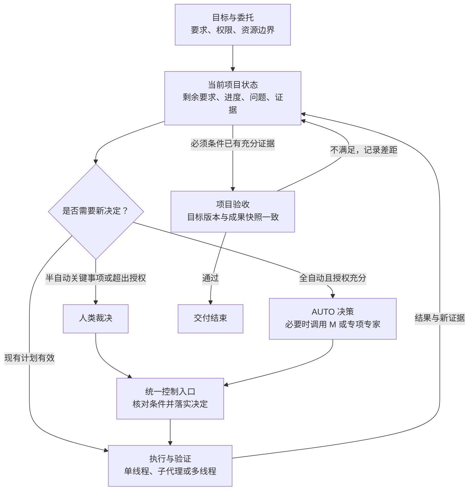

# 开发控制架构：三种模式与自主决策

> 2026-10-15最新决定：[对话驱动工作台v4](conversation-workbench-v4.md)替代本文件的人工默认和旧用户流程，[页面规范](conversation-workbench-v4-ui.md)替代旧控制入口。三模式及持久执行机制可复用；新项目默认自动，已有项目状态不被覆盖。本文作为架构历史保留。

日期：2026-10-11。状态：上层架构决定，待分阶段实现。

依据：用户提供的两份全自动开发讨论及随后确认的评议。本文定义谁作决定、依据什么决定、如何纠偏和结束。持久化、进程恢复、harness 协议及工作树操作属于底层实现，不在本文展开。

本文更新全自动产品设计方向，不代表现有自动策略已实现，也不改变既有运行的模式、模型、暂停状态或授权。半自动已有范围见 [半自动控制契约](../tasks/parallel-development-control.md)。实际实现状态查阅 [进度](../progress.md)，不能从本图推断运行能力。

## 1. 产品目标与三种模式

系统承担可委托的开发组织工作，让用户主要关注目标、约束和重要取舍。评价依据是可验收成果、交付速度、资源消耗和人类参与成本，不以调用次数、提交数量或 Agent 数量代表进展。

| 模式 | 决策责任 | 系统行为 |
|---|---|---|
| 全人工，默认 | 用户直接指挥 | 提供会话、工作包和操作能力；整理计划不自动授权派发 |
| 半自动 | 人类保留最终裁决 | 整理证据、提出建议；按已批准的计划和决定推进机械操作 |
| 全自动 | 系统在明确委托范围内决策 | 自主安排开发、验证、返工和重规划；越界事项交给用户 |

三种模式共享工作包、线程、交付、决策、知识、集成和历史。单 Agent、内部子 Agent、多独立线程是执行组织方式，不是开发模式；三种模式均可使用这些方式。

全自动复用半自动的控制入口，并增加自主决策策略。它不能只给所有待决事项自动点击批准，也不另建一套独立的任务与成果状态。

## 2. 职责：一个控制入口，按需使用智能能力

| 职责 | 负责什么 | 不负责什么 |
|---|---|---|
| 人类 | 目标、硬约束、委托范围和越界裁决 | 不必逐项批准普通实现细节 |
| AUTO，自主决策机制 | 识别待决事项，选择适用策略，在权限与预算内形成决定 | 不成为拥有无限权限的常驻对话 |
| M，按需智能能力 | 为具体问题提供规划、诊断、审核、方案比较 | 不另开绕过控制入口的派工或集成通道 |
| CORE，确定性控制核心 | 核对身份、版本、权限和执行条件，落实决定，记录状态与证据 | 不靠周期性模型推理维持空闲运行，不把语义判断伪装成本地验证 |
| 执行与验证活动 | 产生成果、测试证据和问题反馈 | 不自行修改项目目标或宣告整项验收 |

M 表示智能判断职责，不强制绑定某个模型、固定会话或常驻专家团。复杂问题可以调用专项专家；简单决定使用明确规则即可。专家报告是决策输入，不是新增审批层。实际模型使用始终遵守当前项目成本和授权规则。

执行者、测试和独立审核都能提出问题证据，避免只有一个判断者能触发纠偏。所有来源仍进入同一控制入口，不能因此形成多个最终写入者。

## 3. 上层控制循环

图是半自动与全自动共用的控制抽象。全人工的显式操作同样经过控制入口，但系统不自行发起下一轮开发。框表示职责和活动，不表示必须各启动一个模型。

“现有计划有效”仅继续已授权的动作，不绕过派发、审核或集成门禁。只有相关事件或对账发现状态变化，才判断是否需要新的智能决策；空闲时不定时调用 M。纯本地补扫是底层防漏机制，不等同模型轮询。

## 4. 委托协议与策略优先级

委托可以从项目要求和用户提示形成草案，但推测出来的权限不自动生效。普通内部选择沿用已有授权，不要求用户重复确认。

| 内容 | 必须明确的事项 |
|---|---|
| 目标与验收 | 必须交付什么，用什么证据判断完成 |
| 硬约束 | 不可自行改变的功能、技术栈、运行条件等 |
| 自主范围 | 是否允许调整内部路线、依赖、任务划分和执行组织 |
| 人类保留事项 | 哪些需求变化、外部行为或资源扩张必须批准 |
| 资源边界 | 允许的模型、费用或额度上限、并发和期限 |
| 运行偏好 | 更快交付、节省费用或充分利用已有额度，明确主次 |
| 无人响应 | 继续符合约束的工作；受阻事项保留原因和唤醒条件 |

优先满足授权与必须条件，再在资源边界内优化运行偏好。无法同时满足时记录冲突，不能把期限紧张解释为允许降低必需质量。

“大型项目”是规模特征，“流程自动化”是公共能力，不单列为互相叠加的策略。前端集中呈现委托范围、运行偏好和资源边界三组设置。

有富余额度时，可以开展已授权且有明确价值的探索和验证；不能凭空扩展需求或无限重复审查。额度不可观测时显示未知，使用显式上限，不假设无限可用。诊断和收尾验证应保留预算。

## 5. 稳定目标与可变执行计划

分别维护两类信息：

- **目标与验收清单**：用户要求、必须条件、版本及相应证据。只有获授权的需求决定才能改变它。
- **执行计划**：工作包、依赖、执行者、模型和实现路线。可以在委托范围内调整。

每个工作包关联它承接的目标。每次拆分、合并、撤销或转交，都说明原目标由哪些后继工作承接，保留既有成果和历史。撤销执行方案不等于删除要求，完成所有工作包也不自动等于完成项目。

线程是图节点，一个线程可以承载多个工作包和交付部分。打回绑定具体部分与版本，其他有效成果保留；公共契约变化可能使相关证据过期，需要显式说明受影响范围。

独立、竞争、互补和流水关系沿用半自动契约。拆分或合并不能默默改变这些关系的验收含义。内部子代理无需成为额外项目决策人，但根执行者必须承担其成果、资源和停止状态的汇总责任。

## 6. 决策记录与重规划规则

每个需要改变计划或授权动作的决定，记录以下最小内容；普通机械动作引用已有决定，不反复生成长报告。

| 字段 | 作用 |
|---|---|
| 触发事实与证据引用 | 说明为什么现在需要决定 |
| 对象与版本 | 绑定目标、工作包、交付或成果快照 |
| 选项与选定动作 | 说明继续、修复、研究、重组或请求人类裁决 |
| 权限依据与决策来源 | 明确人类或 AUTO 的有效委托 |
| 影响与资源范围 | 列出受影响工作、预计成本及上限；估算不足如实说明 |
| 成功、失败与停止条件 | 使下一轮可以判断本次决定是否有效 |
| 应用结果 | 区分建议、已批准、已落实、失败和过期 |

正常取得进展时维持当前计划。重规划需要新的证据或目标变化，并考虑上下文迁移、停止在途工作和重新验证的成本。不能仅因另一种组织形式看起来更优就反复拆合。

有效进展包括满足新的验收条件、解除阻断、排除根因假设或降低技术不确定性。重试次数只作辅助信号，不能机械地“失败三次换模型”；也不能以不断产生新解释为由无限重试。每轮诊断和实验都需有资源边界及可判断的结果。

模型选择先采用明确规则和实际任务记录，再渐进优化。调整模型必须具有相应授权；本文不覆盖当前“打回保留原模型、机制测试显式最低成本”等执行规则。不得因自动模式而擅自升级昂贵模型。

## 7. 失败、等待与修复归属

| 情况 | 上层处理 |
|---|---|
| 普通实现错误 | 指定部分返工，保留其他成果 |
| 反复修复但无有效进展 | 形成问题记录，改变根因假设或启动有边界的诊断 |
| 公共接口或跨模块矛盾 | 先归因，再确定公共接口负责人或重组有关工作 |
| 技术路线被证伪 | 比较符合目标的替代方案，按授权改变路线 |
| 需求冲突或权限不足 | 请求人类裁决，继续不受影响的工作 |
| 投递不明、会话失联 | 对账或隔离，不以未交付为由自动重复派发 |
| 服务不可用、资源不足 | 记录恢复条件和探测边界；不是自动升级强模型的理由 |
| 身份、版本或写入范围不合法 | 拒收或隔离，不能沿普通审核获得接受 |

等待记录包含原因、条件、责任方及下一次核查方式。状态事件触发及时检查，纯本地周期对账兜底漏事件；外部条件由受控探测或外部证据确认。循环依赖和无法满足的条件需要明确诊断，不得永久显示“运行中”。

集成失败先区分模块代码、公共接口、集成操作或环境问题，再分配具有适当写入范围的修复者。默认代码修复在独立工作区产生候选成果，重新审核后集成；已实际修改主线的受控修复进入验证与记录，不再次应用同一补丁。两种路径必须明确标识，不混用。

失败现场、主线状态和写入权必须有明确交接结果；释放或转移写入权前，确保原写入者不能继续操作。不默认回滚，也不在主线状态未知时放行其他集成。具体隔离、租约和恢复协议由底层实现验证。

## 8. 人工接管与项目结束

切换模式改变后续决策责任，不等于停止全部线程。暂停、停止执行、撤销工作包和接管决策分别是显式动作。

接管或修改委托产生新的有效权限版本。尚未落实的旧自动决定必须重新核对，不能在人类已改变方向后继续按旧授权执行。已经落实的操作保留事实和证据，按需形成后继修正；不能伪装成从未发生。重新交还 AUTO 时，从当前状态和新委托继续，不重放旧决定。

审核接受、实际集成、项目验收是三个不同阶段。模块待接线可以是有效交付。项目验收需要：

1. 所有必须目标有适用的成果及验证证据，阻断问题已解决。
2. 验证绑定明确的目标版本和成果快照；最终决定再次核对。快照已变化则重新评估，不能拿旧 HEAD 的证明批准新 HEAD。
3. 项目级验证不只拼接执行者的完成声明，必须检查整体行为；重要语义判断按需独立审核。
4. 半自动由人类最终裁决；全自动只在明确委托范围内提交验收决定。执行者不能自行降低标准以获得完成状态。
5. 交付明确成果、证据、重要决定及非阻断剩余项。通过后停止无必要的扩展工作。

系统既要能持续推进，也要能明确结束。所有可执行路径都受阻时，显示具体等待或需裁决状态；不能承诺任何条件下永不停机，也不能用空转冒充无人值守。

## 9. 界面表达

主视图回答四个问题：正在做什么、离目标还有什么、为什么受阻、下一步由谁处理。

- 默认目标总览，可展开阶段和线程内的工作包；保留完整图、二级图和仅运行节点视图。
- 控制核心单独显示空闲监听、决策中或需处理；与执行模型正在工作分开。
- 节点展示局部进度、最近有效证据及待决事项，不只显示“开发中”。没有可测进度时不编造百分比。
- 选择节点才展开改动、模型、版本和历史；不在主图堆放完整协议字段。
- 全自动的重要决定可查看理由、权限依据和影响范围，人工可随时接管。动画回放与真实运行状态明确分开。

## 10. 分阶段实施与验收

以下是新架构的实施顺序，不自动成为生产派工清单；复用已有有效能力，不按表重复造轮子。

| 阶段 | 实施范围 | 必要验收 |
|---|---|---|
| P0：最小自主闭环 | 委托、目标与验收清单、单执行者推进、失败诊断、预算上限、人工接管、明确结束 | 正常完成；部分打回再接受；无进展时转诊断；超权限等待；预算耗尽不追加调用；接管后旧决定不能应用；旧证据不能批准新成果 |
| P1：动态组织 | 独立并行、拆分合并、竞争实验、显式多模型策略和资源分配 | 重组不丢目标；不越过活动写入者；单项阻塞不拖停独立任务；竞争只集成获选成果；模型调整不越权 |
| P2：大型项目 | 分层目标、阶段计划、长期知识、跨任务问题和更精细的策略优化 | 长期目标可追溯；局部变化能定位失效证据；跨阶段恢复后仍能完成一致的项目验收 |

最小的目标追踪、预算和项目验收属于 P0，不能推迟到大型项目阶段。自学习模型路由和常设专家组织不是 P0 前提。

上层先用确定性夹具验证决策和状态迁移，再对接底层执行。真实 harness、持久恢复和无人值守行为单独给证据；模型机制试跑显式使用 `devin/swe-2`。上层测试通过不等于生产闭环通过。
