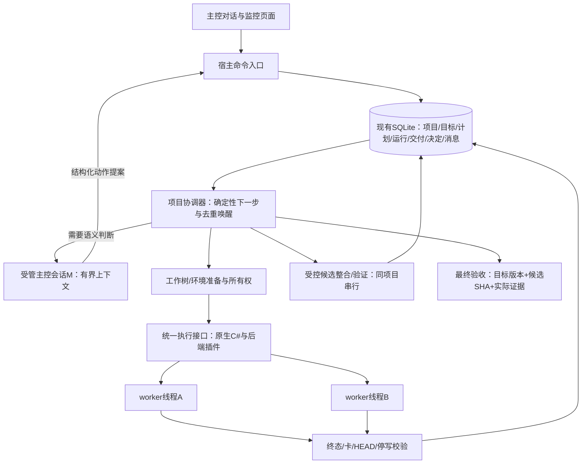

# 工作台v4：默认对话驱动的自主开发

日期：2026-10-15。最新产品决定，替代旧工作台的默认全人工、先填表/连接数据库、仅流程图组织入口。替换用户流程与自主策略，复用现有Core/U1、身份门禁、历史与可用harness，不宣称当前源码已完成改造。

配套：[差距核查](../research/conversation-workbench-gap-2026-10-15.md)、[前端规格](conversation-workbench-v4-ui.md)、[实施与验收](../tasks/conversation-workbench-v4.md)。

## 1. 产品行为

新项目默认选择“自动开发”。用户打开项目，在主控对话说要做什么，系统准备目标和验收、可用内核/模型、修改范围与资源设置，确认的委托范围内自行规划、派工、收取交付、修复、集成并继续。无需用户手动拆prompt、建工作树、转交结果或定时输入“继续”。

默认自动是产品策略，不是默认无限权限。无目标时显示“等待目标”，环境未就绪显示“需要配置”，不启动空模型；普通实现和任务划分不逐项要求用户审批。外部登录/付费/发布、需求取舍或超出已授预算范围进入“需要你决定”。项目委托可一次覆盖允许的自动审核与集成，避免每个步骤都卡人工。

保留“人工接管”“仅建议/半自动”作为主动切换能力。模式、暂停新派工、停止当前执行、停止后台分别建模；切模式不自动杀worker。已有人工/暂停项目不因默认变更被启动，已有自动项目沿原授权继续。

新安装原生C#内核默认；Pi/OMP/DSH/Codex按后端插件契约选择。插件启用、模型可用、具备所需工具与审批能力分别检查。原生尚未实现时明确显示就绪缺口，不回退假回显，也不偷偷换昂贵模型。旧四后端不是原生模式启动依赖。

## 2. 一个控制核心、一套状态、两个worker起步

一台机器一个受管后台宿主可以服务多个项目；同项目一个协调/集成所有者，worker并发与主控串行不是一回事。全局默认两个执行槽，项目可在委托内设更低/更高，但同时受全局资源限制；原生桌面/模拟器等独占资源另外排队，不能因为代码工作树隔离就抢同一设备。

GUI以宿主快照与增量事件为准。既有本地只读快照可做过渡观察，全部新增写操作通过同一宿主命令入口；不让GUI、旧CLI和新服务同时作权威写入者。

## 3. 编程能力，而非提示词愿望

以下是所需能力名称示意，非已有API或RPC承诺。按现有公共契约实现并注册给获授权主控：

| 能力 | 程序必须保证 |
| --- | --- |
| 更新目标/提出计划 | 目标、验收与计划分开版本化；新计划不能悄悄删除要求 |
| 分配执行者 | 校验插件/模型/工具、范围、基线、预算；有界任务上下文 |
| 准备工作树 | 意图先落盘、Git受控创建、环境安装、回执与孤儿资源对账 |
| 发送线程消息 | 持久消息、稳定ID、目标与权限校验、忙时排队、明确处理回执 |
| 原线程续接/取消 | backend原生session绑定、活动输入按能力支持、取消实际停写另确认 |
| 收取交付/返工 | 宿主采集终态与成果，坏卡产生事件；修复带局部范围和新revision |
| 候选集成 | main租约、确定候选与校验、冲突归因、实际Git结果、禁止重复副作用 |
| 状态/验收查询 | 来源时间、缺口、运行身份、目标版本和证据可追溯 |

工具返回结构化结果给主控，主控负责解释与语义选择；实际执行副作用由控制器落实，不能让自由文本日志触发merge或通过验收。模型输出的提案是输入，权限和状态门禁由程序执行。普通工具使用审批与项目开发委托区分。

## 4. 状态与消息

复用Project/Thread/Task/Run/DeliveryPart/Review/Integration及事件表，新增目标/委托版本、协调任务、线程消息/outbox/回执、工作树资源意图和宿主设置。具体表名待源码设计，不另写一套JSON真源。诊断导出不是双向同步数据库。

项目对外状态：等待目标、准备环境、规划中、开发中、审核整合中、需要你决定、等待外部条件、已暂停、恢复核查中、最终验收中、已完成、故障。状态可聚合，但保留每线程/任务部分状态，不能一条绿色完成覆盖另一个失败。

消息生命周期：已保存→待投递→已投递→已确认接收→处理中→已处理；另有失败、投递结果未知、已过期。UI可折叠显示已处理，主控真正处理前不能标“已回应”。稳定消息ID+task/run/revision/HEAD+目标版本关联，不用当前时间每重试生成新ID。

执行结果先保存，再生成同事务协调事件。读取终态文本并校验卡，缺卡/错误格式/进程异常都产生异常结果；不能只在delivery.card存在时才有唤醒。旧卡原文保留，字段不符进入版本化转换/修复，不能宽松解析制造通过。

回传消息早于worker结束时登记待收，真正运行终态/子写入者停止/实际HEAD一致才审。已接受、已整合、已验证、已验收不同；新SHA使相关证据过期。项目结束由目标覆盖+版本一致的最终验收决定，不由worker数为零决定。

## 5. 协调循环与“没有人在干活”

每个新事件先确定性对账、合并同项目待处理原因，取得短期协调租约，然后依次处理：

1. 恢复/未知身份与已有停止请求，保护原所有权。
2. 已有交付/缺卡/失败，形成审核或局部修复任务。
3. 接受成果的整合与必要验证，解锁真实依赖。
4. 委托内有可运行工作且有空位，分配完整包；缺计划才唤醒M规划。
5. 无活跃运行也无可运行工作时，判明已完成、暂停、等人、等外部条件、预算/能力不足、依赖循环或遗漏；生成明确原因与下一检查，不能一直显示“运行中”。

同项目M同一时刻只有一轮决策；忙时新事件合并进待处理队列，不多启动第二个M，也不任意steer正在编辑的worker。任务更新需要活动输入时先检查适配能力，不支持则排到安全边界，不伪称实时打断已生效。

主控上下文由程序生成：当前目标/委托、相关计划部分、变化摘要、交付差异与证据、待决问题、剩余预算、可调用能力。详细原文按需读取，不能把全部日志永远塞到同一个对话。

空闲模型调用为零；有新待决原因才请求模型。每小时本地补扫与即时事件用同一入口，可配置关闭周期；启动/睡眠恢复/进程终态仍对账。模型失败不触发无上限模型重试或自动升级强模型，遵循有界重试与真实错误分流。

## 6. 默认授权、预算与模型

新项目默认自动策略，但第一次提交目标时显示简短委托摘要：允许的仓库范围、自动审核/集成、并发、实现/验证模型、费用或token上限、外部保留操作。沿用户已有配置复用，不强制每次重新确认。未知用量显示未知，用显式次数/token限额兜底，不编造价格/余额。

执行模型按难度选择；测试/机制验证明确最低成本可用模型。确需贵模型验证仍按现有用户规则说明理由/预算并获同意。自动模式不能变成默认最高价、默认联网采购或默认发布。

## 7. 后台、登录启动与迁移

用户级独立宿主在关GUI后保持运行，托盘展示项目数/真正运行/需处理状态。登录启动是独立可选设置，默认不擅改本机；UI关闭、停止自动派工、停止项目、退出后台各有明确效果。

后台程序崩溃与系统重启后，通过PID+出生身份、native session、Git状态和持久消息进行恢复。未知不能重复执行；只恢复已授权自动项目，暂停/人工项目维持原状态。关闭自启/卸载只清本产品登记，数据保留按用户选择。电脑关机不运行；仅“关窗口”能继续，不能混称。

迁移先保存旧状态原样和schema版本，在真实旧队列空闲/停写或明确安全点取得唯一写入权，导入已有项目/会话/工作树/决定并保留标识来源；无副作用影子对账后切换。旧HTML/脚本入口进入诊断只读或退休状态，不能与新宿主竞争派工。

新项目默认自动；已有项目保留模式/暂停/在途状态。用户显式切换旧项目到新自动策略时，从当前版本生成委托/计划，不重新创建已在运行的任务。本改造不直接更改当前外部Codex两小时heartbeat，也不把本提问会话设为新主控。

## 8. 完成条件

必须由产品本身、不靠Codex桌面专属工具跑完整真实流程；同时证明普通推进、返工、缺卡、丢回执、双事件、M忙、重启、人工暂停、权限/预算阻断、集成冲突和最终目标验收。原生C#默认后端未成熟是最终交付依赖，不得用回显桩或插件假切换隐藏。

产品可分纵向包交付，但默认自动可用、后台恢复和新UI必须合起来验收。原有五区/设置基线、资料/会话和受管工作树不被重建。开机启动、生产队列迁移、当前机器配置变化各自记录实做与未做，本设计不是运行证明。
