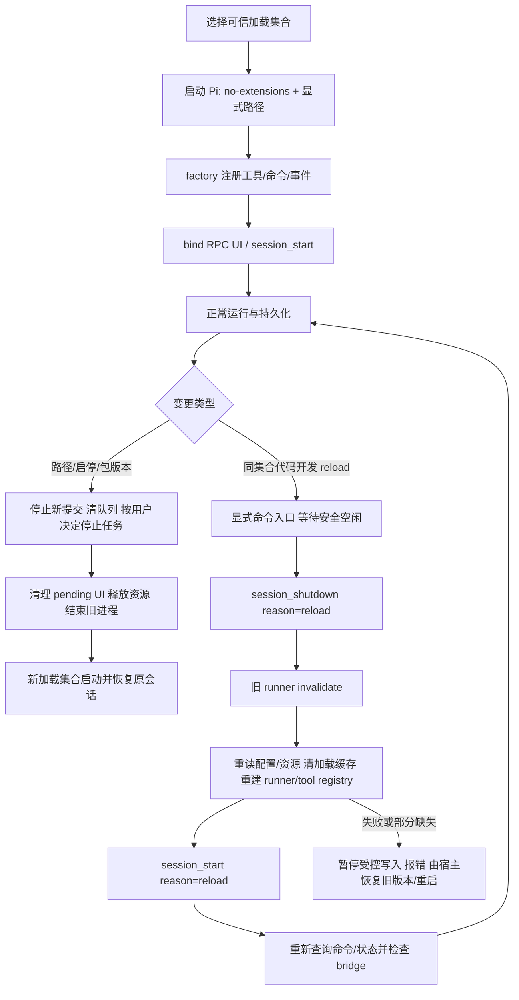
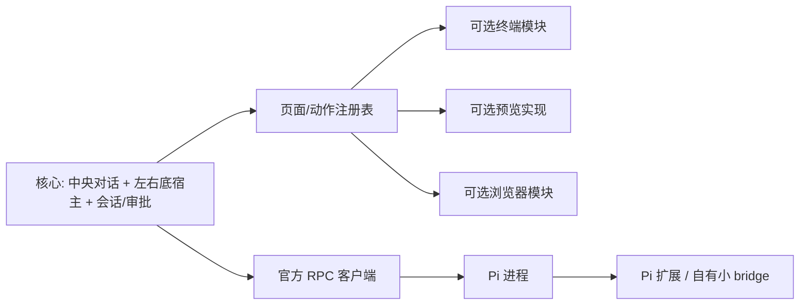
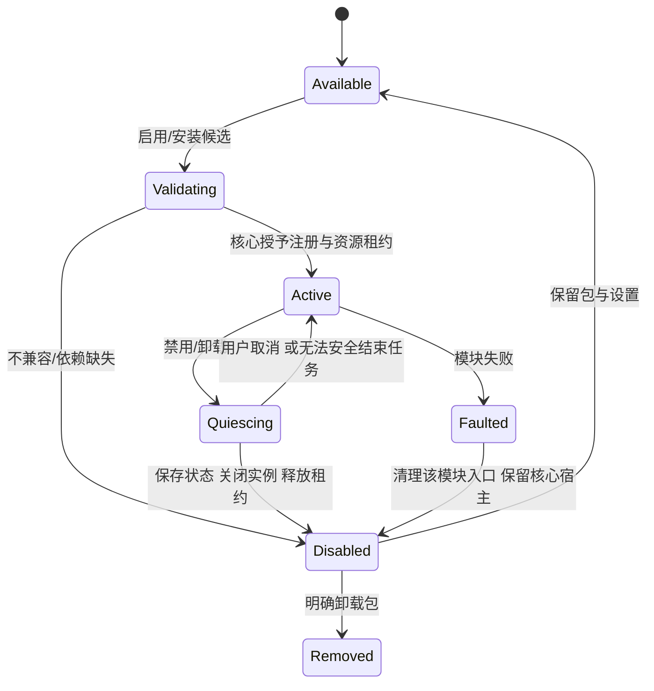

# R01：Pi 插件与前端开放接口研究

日期：2026-10-05（America/Tijuana）。状态：待主 agent 审查。研究基线：`main@4d7c2a26cbdab744924dadb466990783ef2f7725`。本文是研究建议，不是架构决定或已实现能力。

## 1. 结论摘要

1. 本仓实际依赖、lockfile 和安装目录一致为 **`@earendil-works/pi-coding-agent@1.0.0`**，Node 实际为 **24.15.0**。官方 tag `v1.0.0` 对应 commit `a13d35a742c6ef8462812a28fbe1d8c8b7431c32`。不要以 `runtime-baseline.md` 开头的历史 0.87.1 判断当前安装。
2. 分成两层：Pi 扩展负责模型工具、命令、事件、会话数据；Avalonia 模块负责功能页面、动作、布局、平台资源。**中央对话、左/右/底三个宿主、会话协调和审批路由为核心所有，插件不能替换。** 终端、浏览器、预览作为可选实现包，不等于把整个 Shell 插件化。
3. Pi RPC 已提供 `select/confirm/input/editor` 和 `notify/setStatus/setWidget/setTitle/set_editor_text`；widget 只支持文本行。`custom()`、控件工厂、TUI renderer、终端输入和自定义编辑器不能自动变成 Avalonia 页面。[S2][S3]
4. **没有独立 RPC `reload/install/unload` 命令。** 1.0.0 在 RPC 绑定了扩展 command context 的 `ctx.reload()`；可由已注册扩展命令通过 `prompt` 触发。它替换整个扩展 runtime，不能保证单包原子热卸载、正在执行工具迁移或失败自动回滚。[S3][S4]
5. 产品目前用 `--no-extensions` 加显式 bridge/用户路径，CLI 路径列表是进程启动快照；修改用户路径后仍应安全停止并重启。单纯改 Pi settings 后调用 reload，不保证会改变显式加载集合。[L1][S5]
6. 推荐本轮之后的第一个实施增量：**内建可关闭模块的页面注册表 + 浏览器模块关闭/恢复**，复用现有停靠机制，不制作通用第三方 SDK。Pi 管理继续保留重启生效。会话内 reload 单独做授权 PoC。
7. dsh 已核实为官方 `deepseek-ai/deepseek-harness`。固定源码快照显示其 Cordis effects、Loader、HMR 是整体生命周期体系；源码替换、配置更新和包版本替换的行为不同，不能用“一切皆插件”推导任意更新都无需重启。[D1–D4]

## 2. 方法、基线与证据等级

| 分类 | 本报告的用法 |
|---|---|
| 源码事实 | 实际安装包、官方固定 commit 的文档/代码、当前仓库源码，可定位文件和符号 |
| 实测（本轮） | Node `--version`；文件/版本/哈希读取；gh 查询与官方文档逐字节比较。没有启动 Pi、调用模型或操作产品 UI |
| 既有实测记录 | `docs/runtime-baseline.md` 的 1.0.0 探针；本轮只读取记录，未复跑、不当成新验证 |
| 推断/建议 | 前端模块协议、隔离模式、迁移与准入策略、下面的实施顺序 |
| 未证实 | 当前用户 UI 行为、reload 并发/依赖/失败恢复实机结果、dsh 正在运行工具跨代行为、第三方包可信度 |

开工时已有 `scripts/demo-verify/demo-verify-results.json` 修改，以及未跟踪的设计、HTML 原型和研究任务目录；没有恢复或收编这些改动。使用的 `docs/design/frontend-functional-plan.md` 和 `docs/frontend-prototype/index.html` 连同研究相关文件均记入 [local-manifest.json](evidence/local-manifest.json)，含 SHA-256。未假定原型在基线 commit 内，也未将 HTML 可操作样例当真实 Shell/Pi/UI 验证。

本轮未运行产品构建、回归、Pi 实验或安装操作。依据共同协议，实验只交方案，另行授权后执行。

### 2.1 当前版本表

| 对象 | 当前读取结果 / 意义 |
|---|---|
| `runtime/pi/package.json` | 根依赖精确 `1.0.0` |
| `runtime/pi/package-lock.json` | 根依赖及 `node_modules/@earendil-works/pi-coding-agent` 版本均 `1.0.0`；registry tarball 与 integrity 已锁定 |
| 实际 `node_modules` 包 | name=`@earendil-works/pi-coding-agent`，version=`1.0.0`，MIT，Node engines `>=22.19.0` |
| `runtime/node/node.exe --version` | `v24.15.0`，实际命令退出 0，不依赖全局 PATH |
| RPC 入口 | `runtime/pi/node_modules/@earendil-works/pi-coding-agent/dist/bundle/cli.js --mode rpc`，stdin/stdout JSONL |
| 官方源码 | `v1.0.0` → `a13d35a742c6ef8462812a28fbe1d8c8b7431c32` |
| 文档同版本核对 | 官方固定 commit 的 `extensions.md`、`rpc-extension-ui.md` 与安装包文档逐字节相同；见 [pi-reference-sources.json](evidence/pi-reference-sources.json) |
| 既有运行基线 | `runtime-baseline.md` 后半段记录 1.0.0 的 10 项探针、14 项自测、bridge 允许/拒绝和双向文本 fixture；未覆盖本报告 reload/前端模块验收 |

## 3. Pi API 与资源生命周期矩阵

下表基于 Pi 1.0.0。[S1–S6] API 名称属于 Pi，不是拟议的 Avalonia SDK。

| 对象 | 定义、发现与注册 | 生效、调用与持久化 | 变更/移除边界 | RPC 暴露 |
|---|---|---|---|---|
| extension | TS/JS default factory；用户/项目目录、package manifest、显式 `-e`；项目资源受 trust 控制；factory 可 async，启动等待 | factory 注册 `pi.on/registerTool/registerCommand` 等；长期资源在 `session_start` 建立，`session_shutdown` 幂等释放；以 appendEntry/details/外部存储恢复状态 | reload 重建 runtime；不提供通用单扩展卸载 RPC。旧 `pi/ctx` 失效，不能继续使用；factory 成功不等于 session_start 所有资源就绪 | 工具与事件执行留 Pi；命令可查询、以 prompt 调用；受支持 UI 子协议 |
| tool | `pi.registerTool()`，schema、execute、输出 content/details；注册可在加载后进行并刷新工具目录 | 模型选用工具，经 tool_call / execution / result 事件；`pi.setActiveTools()` 控制可用集合 | 激活/停用不等于卸载扩展或撤销已执行副作用；未提供普通 `unregisterTool()` 对称接口；旧工具结果继续存在 | 标准 tool_execution 事件及消息；TUI renderCall/renderResult 不传给客户端 |
| command | `pi.registerCommand(name,{description,handler})`；factory/runtime 内注册 | `get_commands` 查询；`prompt` 的 `/name args` 命中扩展命令即执行，可能返回 disposition=`handled` 而不启动模型 | 可随 runtime 重建消失；command context 有 waitForIdle/reload；扩展命令在 streaming 时也可能立即执行，不能以 prompt 队列语义保证安全 | name/description/source 信息；**不携带通用表单 schema 或权限清单** |
| skill | SKILL.md + scripts/references/assets；启动扫描名称、描述、路径，正文按需读 | 模型可读全文；`/skill:name args` 强制展开，已送入会话的内容不会因移除技能而擦除 | 新增/删除与元数据更新应重新加载资源；已发现技能正文在显式调用时读取，不是完整目录热监视；无单 skill 卸载 RPC | `get_commands` 中 skill 来源；prompt 展开，不是新 executable API |
| prompt template | Markdown 文件名作为命令名；参数占位；配置/package 路径选择 | 进入模型前展开；同名扩展 command 优先；已展开文本属于会话上下文 | 编辑后重新加载资源；没有独立 RPC 模板 CRUD；撤销模板不撤销旧对话 | `get_commands` source=`prompt`；以 `/name` 调用 |
| package | npm/git/local 资源集合，`pi` manifest 声明 extensions/skills/prompts/themes、依赖 | CLI install/remove/list/update/config 管理配置与包；版本化 npm spec、git tag/commit 可固定 | 安装/移除磁盘资源与在用 runtime 是不同动作；依赖下载、脚本、原生模块和回滚要单独管理；local 包不自动安装依赖 | 没有 package install/remove RPC；不得当模型工具调用的天然审批对象 |

補充：`pi.on()` 返回取消该事件注册的函数；1.0.0 也有 provider/MCP/virtual model 的部分注销 API。这些能力不能推广为整个扩展、命令和所有资源都可对称卸载。`pi.events` 是 Pi 进程内扩展通信，不是 C# RPC event bus。[S1][S5]

工具表不等于 RPC 能力协商。`get_commands` 也不是完整扩展 inventory：不注册 command 的 tools-only/event-only 扩展可以完全不出现在命令表。当前 `ExtensionCatalog` 按命令归组只能得到可观测命令来源，不能证明“所有已加载插件”。[L2]

## 4. RPC extension UI 逐项边界

依据固定版本 `rpc-mode.ts` 与相同版本文档。[S2][S3]

| API / 方法 | RPC 行为 | Avalonia 的处理责任 |
|---|---|---|
| select | request 含 id/title/options/可选 timeout；response `value` 或 cancelled | 选项选择，取消返回 cancelled；验证选项属于请求列表 |
| confirm | request title/message/可选 timeout；response confirmed 或 cancelled；取消/超时默认 false | 明确对象及关键参数；默认拒绝；一次回复对应一个连接代次和 id |
| input | request title/placeholder/可选 timeout；response value 或 cancelled | 单行文本与取消；不能假定有额外验证 schema |
| editor | request title/prefill；response value 或 cancelled | 多行编辑。**实现没有 select/confirm/input 同样的 opts.signal/timeout 参数**，客户端必须定义关闭/停止/断线清理 |
| dialog signal/timeout | select/confirm/input 的 abort/timeout 清 pending 并 resolve 默认值 | Pi 不发送独立“请求已取消/过期”事件；客户端需本地计时并在停止/断线时清理。不把 abort Agent 等同于所有弹窗已取消 |
| notify | 单向 request，notifyType info/warning/error | 通知中心或轻量提示，无回复；不当最终任务成功凭据 |
| setStatus | 单向 key/text；text 缺省表示清除 | 按 session+connection generation+key 存储，防跨会话残留 |
| setWidget | 仅 string[] 或 undefined 产生单向 request；factory 被忽略；aboveEditor/belowEditor | 显示文本块；清除指定 key；布局映射由前端决定，不允许 widget 替换中央宿主 |
| setTitle | 单向 title | 可映射会话/窗口次级标题，不允许覆盖核心身份或把字符串当命令 |
| setEditorText / pasteToEditor | `set_editor_text` 单向；paste 退化为 setEditorText | 草稿保护，先保存原草稿并提示替换；不模拟 Ctrl+V |
| getEditorText / getEditorComponent | 分别返回空字符串 / undefined | 插件读不到客户端同步草稿；需要新契约才能双向同步 |
| custom | 返回 undefined | **无法通过现有 RPC 自动翻译任意 TUI 组件** |
| onTerminalInput | 空 unsubscribe | 无终端键盘输入转发；桌面快捷键注册是前端自己的协议 |
| setFooter / setHeader | no-op | 不自动替换 Avalonia 页眉、状态栏或布局 |
| setWorkingMessage / setWorkingVisible / setWorkingIndicator / setHiddenThinkingLabel | no-op | 工作状态从实际事件构建；这些定制不在 RPC 转发范围 |
| addAutocompleteProvider / setEditorComponent | no-op | 前端本地 completion/编辑器模块；不宣称 Pi 的 TUI provider 已接入 |
| getToolsExpanded / setToolsExpanded | false / no-op | 工具卡片折叠由前端维护 |
| getAllThemes / getTheme / setTheme | [] / undefined / `{success:false,error:...}` | Avalonia 主题不随 Pi TUI 主题切换；ctx.ui.theme 仍是 Pi 的 theme 对象，非前端主题能力 |
| custom message/entry/tool renderer | 渲染函数运行在 TUI，不在 UI request 联合类型中 | 解析标准消息/content/details；自有 renderer 可另定版本化数据契约，未知类型保留文本降级 |

RPC 模式 `ctx.mode="rpc"`、`ctx.hasUI=true`，后者只表示有受支持交互路径。要求 TUI 的扩展必须检查 mode；不能只凭 hasUI 判断 custom 可用。

请求例（官方协议，非新增命令）：

```json
{"type":"extension_ui_request","id":"request-1","method":"confirm","title":"Allow write?","message":"target file","timeout":5000}
{"type":"extension_ui_response","id":"request-1","confirmed":false}
```

客户端 `extension_ui_response` 不走普通 request/response ACK；不等待不存在的响应。超时/取消后到达的旧 id 不应重新激活 UI。当前 Core 已分流四种对话框和五种单向方法，记录代次和 pending；此为源码事实，未做本轮 UI 实测。[L3]

## 5. 加载、卸载、reload 与热更新

### 5.1 能做与不能假定的动作

| 动作 | Pi 1.0.0 真实入口 | 本产品结论 |
|---|---|---|
| 初始加载扩展 | CLI `--extension`，配置发现，resource loader | 已有路径选择与显式加载结构；用户启停下次安全重启生效 |
| 会话内新增配置资源 | resource loader 重读配置/发现 + `ctx.reload()` | RPC 中需要已加载 command 才能触发；且 `--no-extensions` 保持排除自动扩展发现，显式路径集不变 |
| 修改当前显式文件代码 | 同路径 reload，clearExtensionCache + jiti `moduleCache:false` | 可研究为开发便利；不能据此保证所有跨包 ESM/CJS/原生依赖都换代 |
| 移除扩展 | 改加载集合后重启，或资源发现集合重建 | 无指定 path 的单包 unload RPC；显式 CLI 文件被删可能产生加载错误，不能拿删文件冒充安全卸载 |
| 触发 reload | `ExtensionCommandContext.reload()`；RPC 将其绑定 `session.reload()` | 官方示例注册 `/reload-runtime` 后以 prompt 调用。该名字属于**示例扩展命令**，没有默认内建 RPC 同名接口 |
| 工具内部触发 reload | 工具只有 ExtensionContext | 官方示例通过 follow-up 用户命令间接调度；不能在任意 tool/lifecycle handler 直接调用 command-only reload |
| 连续文件监听热更新 | 本次检查的通用 resource loader 无自动 source watcher | watcher 与安全调度需要应用/扩展补充；不是 Pi RPC 自带 HMR |
| 单扩展失败回滚 | 未见 whole-runtime reload 的旧 runner 事务恢复 | 不能保证；重启旧包/加载集合可恢复程序，外部副作用和已写会话不会自动回滚 |

### 5.2 源码生命周期图



图中“等待安全空闲、恢复旧版本、重新检查 bridge”是**宿主建议**，不是 session.reload 自带保证。实际 `AgentSession.reload()` 先 shutdown 旧 runner，再 invalidate、重读 settings/resources、重建 runtime、发 session_start；未先调用 waitForIdle，也未保存旧 runner 做失败回滚。[S4]

### 5.3 并发、上下文、依赖与恢复规则

- **执行中的工具**：extension command 会在 streaming 中立即处理。reload command 应显式 `await ctx.waitForIdle()`，前端同时锁住新提交、变更和重复 reload；不能把 `/reload` 输入文本天然当排队指令。空闲门还应包含 compaction/retry、直接 bash、pending UI 和模块任务。工具 callback 还在旧调用栈时强行换代的结果未实测。
- **取消**：用户选择中断时按现有 `clear_queue` → `abort` 路径等待终态，单独处置直接 bash 和 UI。不静默重放写入、prompt 或包管理操作。旧代次 UI 回复不能用来批准新代次工具。
- **已有上下文**：reload 不等于 newSession；历史消息、旧工具结果和已经展开的技能/模板仍在。新能力应影响后续请求，不倒改会话日志。扩展状态在 session_start 根据当前 branch 重建，appendEntry 等持久化 schema 也需版本规则。
- **依赖**：同一扩展文件重新 import 与更换传递依赖不是一回事。包依赖必须先准备好；不在 reload 中临时执行 npm install。原生 DLL、不可控定时器、socket、第三方静态缓存倾向重启 Pi。每包独立 module root，不假定共享依赖实例。[S5][S6]
- **失败**：reload 中单扩展 loader 可记录 errors 后继续；部分缺失不一定抛出全局失败。旧 ctx 已失效，收到 prompt `handled` 也不能证明 reload 完整成功；command handler 异常会发 extension_error，但命令仍被视为 handled。必须核对预期资源和 bridge，必要时停用受控工具并重启旧集合。[S3–S5]
- **回滚**：保存配置、固定包版本及会话备份/格式边界；恢复旧程序不撤销文件写入、Shell 副作用或已发生的数据迁移。禁止自动用旧 prompt 重新执行。

`get_commands` 不足以检查 tools-only 扩展。若要可靠验证 reload，可给应用自有 bridge 增加**拟议的**版本/加载代次/必要能力回执，或采用白名单示例命令行为探针；新增名字应在实现时明确注册，不能文档先声称存在 `get_extensions/get_capabilities`。

## 6. 官方接口直接适配与应用自有 bridge

| 场景 | 直接适配官方 RPC | 应用自有 bridge 补充 | 推荐 |
|---|---|---|---|
| 斜杠菜单/命令面板 | get_commands + sourceInfo，动作填入/调用 prompt | 可提供自有命令的参数说明；第三方命令原数据不带 schema | 共用动作注册表，优先填入草稿；“运行”明确是否会执行代码 |
| 工具权限确认 | RPC UI 收集用户决定，本身不截停工具 | 现有 fufucode-bridge 在 tool_call 等待 confirm，拒绝返回 block | 维持现有桥，普通 UI 协议负责显示/回复 |
| 基本表单 | select/input/editor 可以逐步问答 | 若需要单页复杂表单，可另定受控、版本化数据契约 | 第一增量用标准对话框；复杂表单暂缓 |
| rich form | 没有 JSON Schema form request | 可由自有 custom message 的 details + 已注册 result command 设计相关 id、取消、超时回路；**只是设计候选，必须另做 PoC** | 不向任意 TUI custom 承诺转换；不把 JSON 塞 stdout 发明 RPC 类型 |
| 状态/文本 widget | 五种单向 UI request | 可约定受控自有数据，但应保留文本降级 | 官方方法直接适配；key 归属于会话代次，reload 清理 |
| 工具输出 | content/details、toolCallId、执行事件 | 自有详情 renderer schema，未知类型降级为标准输出 | 输出由 Avalonia 渲染；不得将 Pi TUI component 序列化为控件 |
| 真实已加载能力/加载健康 | get_commands 仅命令，可遗漏扩展 | bridge 可自报版本和自身状态；**不能凭 bridge 自报保证所有第三方扩展都健康** | 管理页区分“已配置/已发现/已观测命令/失败”，后续明确健康证明覆盖范围 |
| 前端注册终端/浏览器/预览 | Pi 无此 RPC API | bridge 不应持有 Avalonia 控件对象 | 仅前端模块协议负责 |

审批不是插件沙箱。Pi extension factory、command 内直接 fs/exec、依赖安装、直接 RPC bash 都可能绕过 tool_call。当前桥对参数快照和重问的处理不能约束其后其他 handler 再修改参数，更不能限制任意扩展代码。需要信任同进程 Pi 扩展，审批只描述受控工具路径。[L4][S1]

建议桥保持小：审批、必要的自有命令和数据版本检查；标准 UI 与 RPC 客户端适配不重复制造另一套 Pi transport。暂不建立通用插件市场或万能 bridge。

## 7. 前端开放边界草案（建议，未实现）

### 7.1 核心与模块



前端可由受限接口注册页面、预览格式 provider、动作、设置 section；不得交出 MainWindow、核心容器、数据库 raw connection、Pi stdin 或审批“批准”内部对象。布局管理在宿主，模块只交可持久化页面状态。菜单执行仍经核心动作路由和 availability 判断。

任务书明确终端可不安装；功能规划则把终端/浏览器/预览列基础版必做。解释应是**产品默认提供哪些模块**由主 agent 定案，**架构允许缺少可选模块时核心继续工作**。不能据此取消产品基础需求，也不能把未安装 terminal 的状态显示成坏掉的空面板。

### 7.2 最小模块记录与注册规则

以下是拟议字段，不是当前仓库已有 SDK：

| 记录 | 建议内容与约束 |
|---|---|
| ModuleDescriptor | 稳定 moduleId、packageVersion、来源、publisher、hash、hostApiRange、平台/runtime 要求、dependencies、capabilities、settingsSchemaVersion |
| PageDescriptor | 稳定 pageTypeId、title/icon、factory、single/multiple instance、允许 dock zones、project/session/global scope、关闭前处理、状态 schemaVersion |
| ActionDescriptor | 稳定 actionId、标题/关键词、availability、执行入口；命令面板和菜单引用同一对象，不注册两套状态 |
| 注册租约 | 启用返回可释放 registration；page/action/preview provider/settings 匿名回调都归租约所有；拒绝覆盖核心 ID 和跨模块抢占 |
| 资源租约 | PTY/子进程、WebView、watcher、事件 subscription 归模块与页面实例；收起和移动不释放，关闭实例才依明确策略释放 |
| 布局记录 | schemaVersion、window/project scope、zone 尺寸/显隐、tab 顺序、active instance、pageTypeId、instanceId、所属 project/session、stateVersion/stateRef |
| 设置 | moduleId 命名空间，迁移副本→校验→原子替换；卸载默认保留，删除数据须明确范围。设置不得带可执行类型名反序列化 |

设置和布局迁移由核心 orchestrator 执行，模块提供**纯转换或受控迁移**；失败保留旧数据和恢复入口，不能让插件迁移阻止主窗口启动。未知/被移除 pageType 使用“模块未启用”占位或跳过并给提示，保留原位置记录用于恢复；不能把该实例误映射为另一个页面。

依赖按图验证：版本不兼容、循环、缺少前置服务就不激活，并显示原因。禁用有依赖的模块先展示影响对象，按反向依赖顺序结束；不悄悄卸载核心页面。内建模块依赖精简，文件树和 Diff 调用统一预览服务；若高级预览实现缺失，核心文件信息/系统打开仍可降级。

### 7.3 模块生命周期与卸载



关闭终端需处理运行进程，停止/保留/取消根据已实现策略选择；移位不重建 PTY。浏览器保存 URL/tab 元数据，不能默认保存敏感站点内容或把 WebView profile 随卸载全删。预览取消 pending 读取、释放文件句柄，移位尽量保留阅读位置。退出需有期限；进程内 DLL 无法保证真正卸载时应明确“已禁用，重启后释放”，不继续删除被占用文件。

现有 `DockRegionView` 的 `WorkbenchPage(Id,Title,Icon,Control)` 可作为第一增量接入点，但还不能等价于完整实例/依赖/租约协议。现有 layout preferences 保存尺寸，不能据此断言插件状态迁移已实现。[L5]

## 8. 三种前端模块方案比较与信任边界

| 方案 | 成本/优势 | 反对理由与边界 | 建议时机 |
|---|---|---|---|
| 内建可关闭模块 | 低；同一构建、可控依赖、复用 Avalonia controls；无需第三方二进制加载 | 关闭功能与卸载物理包不同；仍共享 UI 线程、进程和权限；卸载需资源清理 | **先做**。以页面注册表建立边界，不制作 SDK |
| 进程内 DLL 插件 | 中高；原生 Avalonia 控件/主题/焦点较直接；AssemblyLoadContext + DependencyResolver 可管理不同依赖 | ALC 不是安全边界；卸载是协作式，控件、事件、线程、静态引用会阻止完成；native 崩溃可波及整 App；跨 ALC 接口类型必须共享 | 仅可信签名/人工确认插件，有实际第三方需求后再设计稳定 contract |
| 进程隔离插件 | 高；可单独停止/更新 worker，缩小崩溃传播；按请求授权宿主服务 | 同 Windows 用户启动仍非权限沙箱；IPC、生命周期、取消、流控、版本、资源配额成本；不能把 Avalonia Control 跨进程序列化 | 需要不可信转换器/解析器时研究。worker 返回声明式数据，由核心渲染；浏览器/终端原生 UI 先内建 |

.NET 官方说明 collectible ALC 必须等线程退出且无外部强引用才能卸载；官方插件教程也明确 ALC 不适合加载不可信代码。不应把“DLL 可以 unload”宣传为可靠的任意插件热更新或安全隔离。[M1][M2]

### 8.1 包来源、签名、权限与兼容建议

- 来源优先固定版本内建包，其次人工选择本地包；未来允许 registry/git 时记录 URL、ref、publisher、tarball hash/lock、依赖与完整安装结果。下载成功不表示可信，npm integrity 只证明字节匹配。
- 如引入第三方分发，应由核心维护可信发布者、签名验证、吊销/替换策略，签名覆盖 manifest 和有效载荷；签名证明来源，不能替代代码审核或沙箱。本轮未发现 Pi package 管理自动提供这一整套保证。
- 声明式 permissions 可表达 filesystem/projectRead、processSpawn、network、browserProfile、clipboard、Pi command 等请求。对内建/进程内代码只是宿主服务层限制，不能限制任意 OS API；进程隔离也须另有受限身份/OS 沙箱才能谈强制权限。
- 兼容版本分别维护：Pi version / bridge dataVersion / frontEnd hostApiRange / module settings+page stateVersion；不以同一 packageVersion 混在一起。Avalonia runtime 和宿主契约不兼容时拒绝激活，并允许核心继续启动。
- 控件故障、worker 退出、资源停止超时分别显示，不把“扩展已保存启用”当“本会话已生效”。热更新暂不承诺；更新候选先存旁路版本，安全切换，失败回到旧包和兼容的数据副本。

## 9. dsh 身份与机制对比

### 9.1 身份核实

认证 gh 的 `search repos 'deepseek harness'` 找到官方 `deepseek-ai/deepseek-harness`；repo metadata 与官方 README 同时称其为 DeepSeek AI 开发的 dsh，并给出 `@deepseek-ai/dsh` 启动与官方文档链接。已排除同名 `Dshell`；`dataelement/dsh-desktop`、`anywhere-labs/dsh-desktop` 等是候选桌面载体，**未证实为用户指代的具体客户端**，不拿它们替代官方内核来源。

固定研究 commit：`5badb15009ae1756c3afe0ae0cef1faafc290ccc`，来自 master 读取时快照；根 package.json 版本 `@deepseek-ai/dsh-root@0.2.1-alpha.1`，不是已安装/已运行的发布版。源码 snapshot/哈希和官方固定链接见 [dsh-sources.json](evidence/dsh-sources.json)。本机未安装或运行 dsh。

### 9.2 热更新分层比较

| 维度 | dsh 固定快照的源码/文档事实 | Pi 1.0.0 / Fufucode 的差异 |
|---|---|---|
| 组合模型 | Cordis plugin tree，service/events/effects；agent loop、tool registry 等均可由配置替换 | Pi 内核保留官方，Avalonia 核心 Shell 不开放替换；无需照搬可替换 agent loop |
| 清理 | effects 跟随 plugin scope 释放；plugin.dispose/registry delete 与 fiber settlement | Pi 依赖 session_shutdown；前端必须自己建立 registration/resource leases |
| 默认热监视 | base bundle 的 HMR 配置 `root:[]`，仅显式配置监视；源码监视需配置 root；Headless/SDK/ACP 默认禁用 | Pi resource reload 无同类通用源码 watcher；TUI/SDK能力不自动成为 RPC 行为 |
| 代码替换 | HMR runExclusive 串行协调模块/配置，处理 Node module cache、共享 runtime、多 entry | Pi 重建全 runtime；没有这一套按 module generation 图替换机制 |
| 代码替换失败 | HMR index.ts:703–721 恢复缓存、清新 runtime、重注册旧 plugin；恢复自身也可能报错 | Pi reload 未见旧 runner 恢复事务；不能承诺失败仍保留旧 runtime |
| 普通 Loader 配置更新 | entry.ts:118 起先改 options；disable dispose；volatile-only 可就地提交；开发记录明确普通插件失败可能部分生效、不自动恢复旧配置 | 无法拿 dsh 源码 HMR 的 rollback 解释所有配置更新。Pi/前端也要明确切换成功条件 |
| package 版本替换 | Plugin Manager 与 HMR 文档均要求重启加载新 JS generation；node_modules 默认忽略；安装和 HMR 不共用同一个队列 | 两者都不宜把安装/换依赖承诺为无需重启 |
| 影响范围 | 配置改变影响使用该 profile 的所有会话；安装/管理有批准路径，但 Host 插件仍进程内执行 | Fufucode 应区分 app/project/session 范围，管理动作不继承模型工具批准 |
| 历史与模型上下文 | HMR 不重写会话历史，后续插件能力可能改变请求前缀 | Pi reload 同样不撤销已生成内容；缓存命中和模型结果不保证保持 |
| 运行中工具迁移 | inspected HMR 处理 fibers/module instances；**未证实对所有正在执行 agent tools 有安全迁移保证** | 两者均不能凭热替换机制推断任意工具跨代不中断 |

可借鉴：清理归属、依赖关系、更新串行化、区分 saved/active、失败状态可见。暂不借鉴：替换核心宿主、统一所有东西为插件、Node 内部 module cache hacks。研究样本仅 Pi 1.0.0 与上述 dsh 快照，不作“没有其他 harness 支持”的判断。

## 10. 能力归属与不可实现边界

| 需求 | 归属/判断 |
|---|---|
| 标准 dialog、通知、状态、文本 widget | **Pi 已提供**；Avalonia 做呈现与请求生命周期 |
| tool_call 审批、应用自有 reload command、少量版本化数据 | **bridge 可补**；普通审批桥已有源码，reload/新数据契约需明确实现与 PoC |
| 页面目录、三栏布局、终端实例、预览格式、浏览器进程/profile、模块包与设置迁移 | **仅前端负责**；不能靠 Pi package 注册 Avalonia Control |
| 任意 TUI custom/widget factory/renderer 自动转 Avalonia | **通过现有 RPC 无法实现**；可另做同意范围的前端 renderer，不能承诺通用等价转换 |
| 强制安全卸载任意同进程代码、撤销任意外部副作用、无状态迁移的通用热换代 | **无法作普遍保证**；改用可信代码、明确停止边界、隔离进程和数据备份，仍需特定验收 |
| 可靠通用 third-party SDK/市场 | **当前不推荐**；先让真实内建模块使用小接口，收集需求后稳定协议 |

## 11. 最小 PoC 与第一个实施增量

共同协议禁止本轮实验；下面均为**未运行方案**。执行前由主 agent/用户另行授权并确定允许路径。

### 11.1 推荐先做：浏览器模块关闭/恢复 + 核心页面注册表

范围：利用现有 DockRegionView 接入内建 module/page registration，先迁一项浏览器；保留现有 Pi RPC/审批与中央会话，布局记录稳定 pageTypeId/instanceId。实现只是内部接口，不开放 DLL 扫描或 npm 自动安装，不需要通用 SDK。

行为验收：

1. 启用时浏览器页面可在左/右/底打开、排序、移位；同一 instance 的地址/阅读状态不重建丢失。
2. 禁用前关闭/保存该模块实例，取消 pending 初始化，释放 WebView 与回调；三个宿主和中央草稿仍可操作，浏览器入口准确显示不可用原因。
3. 持久化的 browser 页面记录在模块缺失时不阻止启动；恢复启用后原布局位置可恢复，unknown stateVersion 有降级。
4. WebView2 缺失/初始化失败只影响浏览器模块；用户能查看诊断并继续会话。
5. 无关核心页不能被模块 ID 覆盖；关闭区域不关闭活跃实例。移位不产生重复 WebView；App 退出无该模块后台残留。

必要验证：注册/布局序列化与禁用状态的定向无头行为；一次真实 Avalonia+WebView2 页面打开/移位/禁用/重启恢复。具体 Windows 资源释放和焦点必须实机，不能只以 mock 成功代替。不做与改动无关的全仓回归。

### 11.2 独立后续 PoC：Pi 受控 runtime reload

范围：固定当前 Node/Pi 包，隔离且禁用户资源发现的临时配置/会话；无凭据、无云模型。仅显式加载自有最小实验扩展，提供 `/reload-runtime`、可观察版本标记和样例工具；新命令均真实 register，不能伪造内建 RPC。启动参数、输出和文件操作授权由主 agent 决定。

场景及验收：

| 场景 | 行为证明要求 |
|---|---|
| RPC UI | select/confirm/input/editor 正常与 cancelled；三种 opts timeout/signal；editor 显式关闭；UI response 无 ACK；迟到回复不复活 |
| 文本/控件 | status/widget clear；factory/custom 无客户端组件；TUI-only no-op 不让 command 永久等待 |
| 同路径换代码 | v1→v2 后 command 行为与 source/version 可观测；旧 ctx 不再可用；session id 和既有 entries 保持；shutdown/start 各有证据 |
| 生命周期资源 | watcher/timer/event handler 不重复；关闭后无残留；工具输出和持久化 entries 可解释 |
| 忙时 reload | 用隔离合成模型/可控长工具，发 reload command；waitForIdle 与新提交门使其只在任务终态后生效；停止/取消无无限等待 |
| 加载错误 | factory/session_start/依赖缺失分别注入；不能把 prompt handled 当成功；预期 bridge 缺失时停住受控写入，能重启旧集合 |
| 改加载路径 | 证明旧 CLI snapshot 不能仅靠 settings reload 任意增删显式扩展；重启路径变更实际生效 |

证据应记录 JSONL 事件顺序、连接代次、命令响应、扩展 version、有限 stderr、文件效果与进程退出；不记录 prompt 私密正文或 auth。复用现有 pi-probe 的合成模型思路，遵循 agent_settled 终态而非只等 agent_end。不要改产品测试断言或放宽故障条件。

### 11.3 后置验证

仅在选择第三方模块模式时才做 ALC 卸载弱引用/线程与 native 句柄验证或 worker IPC 崩溃隔离验证。当前不实现。浏览器 first increment 之后再迁终端，针对 PTY 活跃任务与关闭取消做行为验证；第三个增量统一 Preview provider 的卸载/格式降级。

## 12. 实施影响、风险与开放问题

| 项目 | 影响与处理 |
|---|---|
| Core/Pi 契约 | 第一个前端模块增量尽量不修改 Pi/Core 公共签名；未来 reload 要先定义 generation、健康回执和空闲门 |
| 现有扩展管理 | 保留待生效/安全重启语义，修正文档中旧只读注释与当前可管理路径的口径；不在本研究修改源码 |
| 身份/信任 | 命令来源不足以证明扩展完整加载；签名/权限声明不隔离同进程任意代码 |
| 布局迁移 | module/page/instance ID 稳定；缺失模块不导致核心布局反序列化失败；settings 与 layout 分开版本 |
| 审批桥 | 同进程其他扩展可绕过或影响审批参数，bridge 的健康失败须明确处理；不得声称插件沙箱 |
| 资源与崩溃 | 进程内异常可尽力降级，native crash/卡住 UI 线程无法由租约保证隔离；第三方高风险部分再评估 worker |
| 版本漂移 | npm 包固定 1.0.0，dsh 快速变化；报告仅对应保存的 commit/字节，不声称 latest 发布一致 |
| rollback | 状态迁移与外部副作用需分别讨论；旧包可恢复不等于旧数据无损可回退 |

主 agent 待决定：

1. 可选模块的默认分发范围与缺失时降级；终端是否默认装入，浏览器/高级预览能否关闭。
2. 页面实例与布局的 app/project/window 层级，以及卸载后记录保留策略。
3. 是否确有第三方原生 UI 插件需求；没有则继续内部模块，暂不发布 SDK。
4. 会话内 reload 是开发便利还是产品承诺；若仅开发便利，可先只允许可信同路径扩展。
5. 复杂表单、自有输出 renderer 是否值得追加 bridge 数据协议；没有实际场景则保留标准 UI。
6. 用户启发来自哪一个 dsh 桌面客户端仍未确认；官方内核已核实，具体客户端与本报告不混为一谈。

## 13. 一手来源与证据索引

所有 Pi 官方链接固定在 1.0.0 tag 所指 commit；安装包源码快照见 evidence 的 `pi-dist__...`，哈希见 local-manifest。上游 TS 源码快照见 `pi-upstream-...`。

| ID | 来源与定位 |
|---|---|
| S1 | [Pi extensions](https://github.com/earendil-works/pi/blob/a13d35a742c6ef8462812a28fbe1d8c8b7431c32/packages/coding-agent/docs/extensions.md)，Lifecycle/Contracts/Context/State/UI/Errors；安装包 `dist/core/extensions/types.d.ts` 的 ExtensionAPI 与 ExtensionCommandContext |
| S2 | [RPC extension UI](https://github.com/earendil-works/pi/blob/a13d35a742c6ef8462812a28fbe1d8c8b7431c32/packages/coding-agent/docs/rpc-extension-ui.md)，Methods/Limitations/Responses |
| S3 | [RPC implementation](https://github.com/earendil-works/pi/blob/a13d35a742c6ef8462812a28fbe1d8c8b7431c32/packages/coding-agent/src/modes/rpc/rpc-mode.ts#L91)，createDialogPromise、createExtensionUIContext、editor（254）、rebindSession reload（341）、get_commands（680）、extension_ui_response（771）；[RPC commands](https://github.com/earendil-works/pi/blob/a13d35a742c6ef8462812a28fbe1d8c8b7431c32/packages/coding-agent/docs/rpc-commands.md) |
| S4 | [AgentSession.reload](https://github.com/earendil-works/pi/blob/a13d35a742c6ef8462812a28fbe1d8c8b7431c32/packages/coding-agent/src/core/agent-session.ts#L3612)，以及 prompt（1928）、_tryExecuteExtensionCommand（2069）；[reload-runtime example](https://github.com/earendil-works/pi/blob/a13d35a742c6ef8462812a28fbe1d8c8b7431c32/packages/coding-agent/examples/extensions/reload-runtime.ts) |
| S5 | [Extension loader](https://github.com/earendil-works/pi/blob/a13d35a742c6ef8462812a28fbe1d8c8b7431c32/packages/coding-agent/src/core/extensions/loader.ts#L288)，registerTool、registerCommand、clearExtensionCache、jiti moduleCache（570）；安装包 `dist/core/resource-loader.js:350–417` reload，`dist/core/extensions/runner.js:717–751` createCommandContext |
| S6 | [Packages](https://github.com/earendil-works/pi/blob/a13d35a742c6ef8462812a28fbe1d8c8b7431c32/packages/coding-agent/docs/packages.md)、[Skills](https://github.com/earendil-works/pi/blob/a13d35a742c6ef8462812a28fbe1d8c8b7431c32/packages/coding-agent/docs/skills.md)、[Prompt templates](https://github.com/earendil-works/pi/blob/a13d35a742c6ef8462812a28fbe1d8c8b7431c32/packages/coding-agent/docs/prompt-templates.md)、[Security](https://github.com/earendil-works/pi/blob/a13d35a742c6ef8462812a28fbe1d8c8b7431c32/packages/coding-agent/docs/security.md) |
| L1 | 当前仓库 `src/Fufucode.Core/PersistentSessionManager.cs`，OpenAsync 与 UserExtensionPaths；显式参数在 231–239 左右，文件 SHA 见 manifest |
| L2 | 当前仓库 `src/Fufucode.App/Integration/ExtensionCatalog.cs`，QueryAsync/GroupLoadedExtensions；ViewModels/ExtensionsPageViewModel.cs 的 pendingPaths/Restart guard；源码旧注释不等于当前真实行为 |
| L3 | 当前仓库 `src/Fufucode.Core/ChatSessionCoordinator.cs:511–528`，dialog/notification 分流；`src/Fufucode.Pi/PiRpcClient.cs:174`，UI response 写入 |
| L4 | 当前仓库 `extensions/fufucode-bridge/index.ts`，tool_call、snapshot、ask、block；不属于万能权限边界 |
| L5 | 当前仓库 `src/Fufucode.App/Views/DockRegionView.cs` 的 WorkbenchPage/Catalog；Infrastructure/WorkspaceLayoutPreferences.cs 的尺寸持久化；`docs/design/frontend-functional-plan.md` 为未提交方案 |
| D1 | [Official dsh README](https://github.com/deepseek-ai/deepseek-harness/blob/5badb15009ae1756c3afe0ae0cef1faafc290ccc/README.md)、[Architecture](https://github.com/deepseek-ai/deepseek-harness/blob/5badb15009ae1756c3afe0ae0cef1faafc290ccc/docs/architecture.md)，身份/profile/插件架构；[Cordis lifecycle](https://github.com/deepseek-ai/deepseek-harness/blob/5badb15009ae1756c3afe0ae0cef1faafc290ccc/docs/cordis-tutorial/02-lifecycle-and-effects.md) |
| D2 | [dsh HMR README](https://github.com/deepseek-ai/deepseek-harness/blob/5badb15009ae1756c3afe0ae0cef1faafc290ccc/packages/boot/hmr/README.md)，默认 config-only、包替换重启、Node internals；[HMR implementation](https://github.com/deepseek-ai/deepseek-harness/blob/5badb15009ae1756c3afe0ae0cef1faafc290ccc/packages/boot/hmr/src/index.ts#L678)，替换/rollback |
| D3 | [Loader entry](https://github.com/deepseek-ai/deepseek-harness/blob/5badb15009ae1756c3afe0ae0cef1faafc290ccc/vendor/loader/src/config/entry.ts#L118)；[nontransactional Loader decision](https://github.com/deepseek-ai/deepseek-harness/blob/5badb15009ae1756c3afe0ae0cef1faafc290ccc/.agents/notes/implemented/simplification/2026-09-09-nontransactional-loader.md)，普通配置失败不承诺回滚 |
| D4 | [Plugin Manager](https://github.com/deepseek-ai/deepseek-harness/blob/5badb15009ae1756c3afe0ae0cef1faafc290ccc/packages/boot/plugin-manager/README.md)，profile 影响范围、安装批准、restart/Failure behavior；源码 operations.ts 和 index.ts 快照可追溯 |
| M1 | [Microsoft .NET unloadability](https://learn.microsoft.com/en-us/dotnet/standard/assembly/unloadability)，cooperative unloading / references / threads。2026-10-05 阅读；尚未验证本仓控件卸载 |
| M2 | [Microsoft .NET plugins tutorial](https://learn.microsoft.com/en-us/dotnet/core/tutorials/creating-app-with-plugin-support)，ALC/DependencyResolver 与不可信代码边界。2026-10-05 阅读；尚未应用本仓 |

取证脚本：`collect-evidence.mjs`（本地哈希和 gh metadata/tree）、`fetch-upstream.mjs`（dsh 固定源码）、`fetch-pi-reference.mjs`（Pi 固定源码与文档比较）。它们只收集文件/官方 API 数据，写入仅 R01，不启动 Pi 或执行下载的第三方代码。

## 14. 交付检查

- 已覆盖任务书 7 个问题、API/UI 矩阵、两层生命周期图、三类前端方案、来源与版本、最小独立增量及 PoC 行为验收。
- 本轮所有新文件仅在 `docs/research-results/R01/`；没有 Git 写操作、产品修改、插件安装、Pi 更新、凭据读取、worktree 创建或实验执行。
- 运行验证项：只读证据采集、文档同版本字节核对、交付路径/引用/哈希检查；结果另见 `verification.md`。
- 未验证：Pi reload 的真实行为、复杂 form bridge、ALC/worker、Avalonia 控件与布局/资源卸载、dsh HMR 实机运行。实验和正式决定交主 agent。
