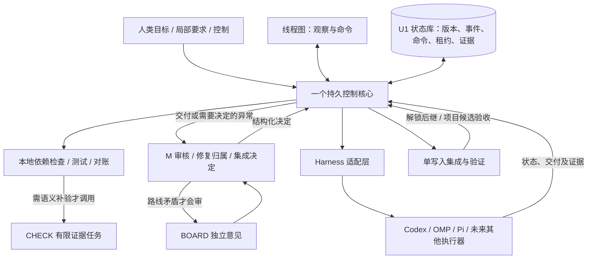

# 自动开发控制架构审计

2026-10-11。本次是源码、持久记录和公开项目研究；没有启动模型或迁移生产调度器。

## 判断

现有方向可行，但实现处于“控制进程偏碎、恢复协议尚未收口”的阶段。应该减少协调环节，增强确定性状态管理，不增加常驻模型。项目需要一个可靠控制核心、一个最终决定角色 M、按需执行者；CHECK 是可选验证活动，BOARD 是低频会审活动。角色不应天然对应独立长寿命模型会话。

用户需要的是可核对的自主推进：离开后有人负责，回来能一眼知道成果、停顿原因和下一责任方。线程图是解释开发工作及提供局部控制的界面，不应成为后台进程名册。动画只代表观察到的活动，不用动画证明服务健康。

## 本次观察

- main 为 `894097ceabae8ff82defd9fbc8dadc56bf044cca`。D4-SNAPSHOT、M0、U1 各有 done 记录；U1 已有 SQLite 事务状态库 `src/Fufucode.Core/Automation/AutomationStore.cs`，应复用，不能又从零造一套。
- CLI 生产仍读取 `tmp/agent-*` 文件，尚未改为 U1 状态库。文件原子替换保护单次写入，不保证 review、claim、任务状态跨文件原子一致。
- R-066 已出现“有效打回决定落盘、claim 未推进”导致续派卡住；R-067 已出现验证报告解析失败阻断审核。这证明交接复杂度已经影响吞吐。
- U3 第三轮仍为 rework，命中修复次数上限。`tmp/agent-flow/blocked-U3.json` 明确冻结。三个实际问题是模板点击身份不匹配、Canvas 定位容器错误、部分选择入口未接。次数上限有意义，但应转入明确修复协调事件；不能止于写一个 blocked 文件。
- M 持久状态 ready，上次完成 `2026-10-11T10:03:21Z`；不是正在工作的模型。监督器运行记录启动时间约 `11:56:23Z`，控制台可读取；当前 `/api/state` 对四个宿主均返回 processAlive=false。CIM/任务计划查询被本次环境拒绝，因此不把文件 PID 当作活进程，也不据此断言已验证重启恢复。
- 原 UI 把“没有暂停”显示为“调度中”，把 inflight 字符串当活模型，并将控制门禁计入阶段完成进度。以上显示本次修正；API 新增 M 进程身份核对及未解决阻塞投影。

## 可借鉴的实现

先按职责比较，再选择，不把不同层次的产品当互斥候选。GitHub gh 搜索成功，内容 API 受限后使用官方公开页面。没有安装、运行或做跨后端兼容承诺。

| 来源 | 已核实的设计 | 对本项目的取舍 |
| --- | --- | --- |
| [Herdr 持久化](https://herdr.dev/docs/persistence-remote/) / [Socket API](https://herdr.dev/docs/socket-api/) | 终端服务与客户端分离；事件流与状态查询分别提供 | 可选终端托管与观察层。不能代替任务验收、Git 写入门或持久业务事件；关窗存活和关机恢复要分验 |
| [Pi Durable](https://github.com/earendil-works/pi/blob/main/packages/durable/README.md) | 提交后可见、持久任务、requestId 重用、恢复 pending；明确标实验性 API | 借鉴提交身份与恢复语义；作为独立 harness 适配，不把它说成普通 Pi RPC 的开关，不据此重写已用官方引擎 |
| [Temporal Activities](https://docs.temporal.io/activities) / [Tasks](https://docs.temporal.io/tasks) | 工作流状态与外部活动分离；活动可能重试，副作用仍需幂等 | 最值得借鉴的控制原则。当前单机先复用 U1 SQLite，不为这一规模引入额外服务集群；未来多机再评估直接采用 |
| [LangGraph Persistence](https://docs.langchain.com/oss/python/langgraph/persistence) | thread/checkpoint、恢复与状态历史 | 适合模型决策子流程；检查点不能自动证明 Git 操作仅执行一次，也不替代项目控制数据库 |
| [ACP](https://github.com/agentclientprotocol/agent-client-protocol) | 标准化客户端/agent 通信及能力声明；会话恢复依能力支持 | 优先采用已有后端支持的标准适配；协议连接不等于持久任务调度 |
| [LingTai](https://github.com/Lingtai-AI/lingtai) / [结构文档](https://github.com/Lingtai-AI/lingtai/blob/main/ANATOMY.md) | 当前面向长期 scientist、持久知识与技能、专家 avatar、coding CLI daemon；文件状态仍可检查，邮件只是其中一层 | 学习持久知识和有边界的委派，不复制松散邮件作为工程权威状态。不能再把当前 LingTai 简化为“只有 agent 互发邮件” |

邮件本身不导致工程失控。真正风险是把自然语言邮件当任务批准、完成或所有权变更的唯一依据。邮件、UI、CLI 都可以是输入通道，但必须转换成带身份、版本、预期状态的命令；是否生效由同一个事务入口决定。

## 收敛后的控制结构

核心不进行推理轮询。周期任务只做本地对账与期限检测；有新的可行动原因才生成唯一决策事件。一次普通交付应是：本地验证 → M 决定 → 确定性应用。不要强制每次经过 CHECK、M、三个专家再转回 M。

M 是决策职责和持久身份，不应靠无限增长的一条聊天记录保存全项目真相。近期保留原生产会话及原会话回修约定；未来通过明确的会话交接协议，把任务版本、差异、证据和未决问题打包成有界决策上下文。不能偷偷换会话或模型。

## 通用 Harness 控制契约（设计，尚未全部接线）

控制器只认识 project/thread/task/part/revision/run/command/event 身份，不认识某个 CLI 的屏幕文字。

| 操作 | 必须返回或保存 | 不支持时 |
| --- | --- | --- |
| DescribeCapabilities | adapter/version、start、saved-session-resume、observe、cancel、input-while-running、child-agent、approval 能力 | 显式 false/unknown，不从模型名称推断 |
| Start(commandId, executionSpec) | 先落盘 claim；显式模型/目录/允许范围/契约版本；原生会话身份及启动回执 | 不自动换 harness 或模型 |
| Observe(runId, cursor) | 公开执行事件、游标、进程出生身份；区分 accepted/running/stopped/delivery | 不以“工具没有输出”推断完成 |
| Resume(commandId, savedSessionId) | 原 harness/model/worktree/session 绑定，新 runId，旧版本保留 | 返回不支持，交明确恢复决定 |
| Cancel(commandId, runId) | 请求已接受与实际停止分别记录；停止后才释放写入权 | 保留所有权，不能假停止 |
| Reconcile(runId) | 原生结果、交付/决定及副作用证据，返回 resolved/unknown | unknown 冻结该 run，不自动重发 |

DeepSeek 如果只是供应商模型名，不等于新增 harness。实际可调用执行器具备什么 API/保存格式，就实现什么适配能力。子代理归属根执行租约；根 agent 退出但子写入者未停，不能收交付。CUA 只用于没有可靠接口的人工辅助边界，不进入无人值守关键路径。

## 渐进实施顺序

1. 可观测性先纠正：活进程、最后有效进展、阻塞原因与下一责任方分别显示；本次已修改 HTML 和 API，原生页面另行接线。
2. 统一事务入口：扩展已集成 U1，任务状态/事件/outbox 同事务；旧 JSON 只作导入和只读导出。影子对账通过后逐类切换，禁止两个权威写入源。
3. 适配器抽离：保留现有 Codex/OMP 行为作契约测试，加版本化能力表；Pi 单独验证；不把新适配器上线与全量存储迁移绑成一次大改。
4. 有限自动恢复：启动、投递回执、执行、终态分别记录，增加子进程身份和故障分类；次数耗尽只产生一个修复协调事件，保留原失败证据。未知副作用交 M 核对，其他无依赖任务继续。
5. 收口局部契约采用、集成失败归属、WAIT 对账/期限、项目级验收四个边界。已有概念模型仍有效；明确 owner/reason/condition/nextAction，不能只给 waiting。

切换验收覆盖：空闲零模型、重复事件零增派、断电后积压恢复、发送成功但回执丢失不重发、活动子写入者阻断交付、单写入、局部打回保留其他部分、需求更新使旧验收失效、集成失败正确归属、项目终验绑定版本。模型部分仅显式 devin/swe-2。

“永不停机”不是合理承诺。可交付保证应是：有证据可安全推进的继续；可判定故障自动恢复；不明副作用不重复执行；无法自动处理的形成可定位的异常和负责人，不静默假装运行。
