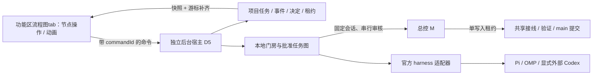

# 自动开发编排：可学习实现与 Fufucode 接入选择

调研日期：2026-10-10 当地日期。GitHub main/HEAD 查询发生于次日 UTC；下列 SHA 是研究快照，不是已安装版本。仅查官方仓库、官方文档，未安装第三方依赖或启动模型试跑。

## 结论

建议采用 **Fufucode 独立后台宿主 + 项目任务状态机 + 官方 harness 适配器 + 既有五区界面**。当前已经跑通的门房脚本作为行为基线和迁移桥接。不要重写 Pi 的模型调用、工具循环和原生子代理；不要用终端显示文本判断交付或决定。

有可学习的现成实现，但职责不同。以下是源码/文档事实与接入判断；没有把上游 README 当作本机兼容验证。

| 选项 | 官方能力 | 可学习部分 | Fufucode 接入判断 |
| --- | --- | --- | --- |
| [Pi Durable](https://github.com/earendil-works/pi/blob/main/packages/durable/README.md) | 持久会话、模型/工具任务与应用状态；提交后可见；SQLite/JSONL 重开恢复；requestId 去重；实验性 API | 持久任务、先落盘再投递、恢复和会话身份 | 单个 harness 的候选引擎；不是当前 Pi RPC 的透明开关，也不承担跨 harness Git 审核集成。先独立适配试验，不作为首轮硬依赖 |
| [Herdr](https://herdr.dev/docs/persistence-remote/) | 独立后台 server 托管终端，客户端 detach 后 panes 继续；会话形状恢复与进程延续分开 | 独立宿主、观察端与控制端分离、原会话绑定 | 可选外部终端运行层；无需为 Fufucode GUI 强行套一层 Herdr。关闭客户端不等于断电后进程继续 |
| [Pi Fabric](https://github.com/fabric-runtime/pi-fabric) | agents/actors、持久 mesh、CAS 共享状态、runner 与决策契约 | 投递定位先保存、租约与原子争用、事件驱动 actor | 可选 Pi 扩展能力；首版不引入其整套执行内核。借鉴持久协调契约；跨引擎契约仍归 Fufucode |
| [Pi Agent Orchestrator](https://github.com/GroepOnline/pi-agent-orchestrator) | 子代理生命周期、队列、工作树、结构化交接、调度与 TUI；默认单执行策略 | 任务卡、受限子任务、并发与工作树可视化 | 可选 Pi 执行侧扩展；运行在 Pi host 内，不能据此证明 GUI 关闭后的独立存活或满足本项目审核门禁 |

许可证与快照：Pi MIT `ea448f454af474f3e2fe9733b331e17b0662f5d6`；Herdr Apache-2.0 `2563803dca97c040beaf3dc3acdcb5a3221b4238`；Pi Fabric MIT `cd9435c1f69d2deb07350d779bd9978cec7e4055`；Pi Agent Orchestrator MIT `7208bdb089f15c7d371407531d53394fb2a61f6a`。以上通过已认证 `gh repo view` / `gh api .../commits/HEAD` 查询；若实际引入代码，另保留对应许可证和版本锁定。

## Herdr 的准确边界

[Socket API](https://herdr.dev/docs/socket-api/) 的 `events.subscribe` 提供运行期推送，但事件历史不持久；`events_lost` 后须重订阅并用权威快照对账。快照与事件没有共享序号边界。它不能代替项目的持久事件游标、delivery 和 review 记录，也不能保证给任意已打开的 coding-agent thread 安全发消息。

[Agent 文档](https://herdr.dev/docs/agents/) 描述自报生命周期优先及屏幕状态检测；这些适合展示运行状态，不是本项目结构化交付、独立审核或验收依据。适配必须绑定明确的 pane/terminal/native-session 身份和唯一控制者。

[Windows 文档](https://herdr.dev/docs/windows-beta/) 使用原生 ConPTY 并记录特定终端输入/渲染限制。是否采用它作为运行层，要针对当前 Windows 构建测进程树、断开、重启与会话控制，不根据其他平台演示下结论。

## 本项目的实际基线

- 脚本已经区分 gate（仅审核）与 workflow（批准任务图、原会话回修、共享集成、依赖续派）。见 [生产监督记录](../records/M-event-workflow-production-2026-10-10.md) 与 [跨 harness 全流程记录](../records/M-cross-harness-flow-2026-10-10.md)。具体记录文件名以仓库现有文件为准。
- 2026-10-11 04:04 UTC，真实 D4-SNAPSHOT 第二轮 `791deb5bb655448bad77f3995c5b6191` 已完成独立审核与主线收编。源 HEAD `ef18d70263fb0076719222d5fdafe507523a37d0`；集成记录 mainSha `57cedd57010e452a1d77c683f224b31ccf510819`。本地证据 `tmp/agent-flow/integration-D4-SNAPSHOT-791deb5bb655448bad77f3995c5b6191.json` 与同目录 `verify-D4-SNAPSHOT-791deb5bb655448bad77f3995c5b6191.log`。此结论只覆盖该 Core 子任务，不替代 D4 整项、G1/G2 或新 GUI 产品验收。
- 现有 `PersistentSessionManager` 管理官方后端进程与保存历史。恢复历史和恢复正在执行的工具是不同能力；新宿主应如实报告能力和不可确定状态。

## 产品化路线

跨 harness 指不同任务可选择不同执行器。一个任务的修复仍回原 harness、原模型、原会话、原工作树。Pi 原生子代理与外部执行会话分别建模，不能冒充同一种进程或隔离机制。

本轮先交付 [HTML 原型](../frontend-prototype/automation/index.html) 供用户讨论信息布局、自动化控制粒度和异常恢复；同时把 U0–U3 纳入 [产品任务书](../tasks/automation-workbench.md)。底层任务状态和非依赖模块可以先做；G1/G2 不因脚本成功而跳过。
