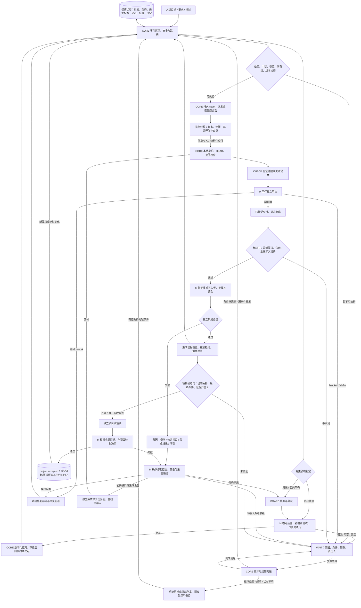

# 全自动开发门控：概念模型与闭环边界

2026-10-11 后续设计入口：[三模式与自主决策架构](../design/autonomous-development-control.md)。以下固定角色图保留为早期控制边界参考；最新设计采用 AUTO 决策机制、按需 M/专家活动与统一 CORE 入口，不要求逐级经过 CHECK/BOARD。下文不作为新自动策略已实现的证明。

这是目标控制模型，不是当前全部功能的实现声明。无具体项目节点。对外四组：CORE（本地控制核心，含事件门房与调度）、CHECK（低成本证据验证）、M（最终决定及集成协调）、BOARD（低频路线专家团）。执行节点是保存的对话线程；线程包含任务、步骤、交付部分及修复版本。

## 1. 局部需求补充

普通验收补充无需 BOARD。人类请求先落盘，绑定 taskId、stepId/partId、baseRevision 和明确验收条件；M 检查授权、范围、依赖、公共接口影响及已有交付，决定 accept/rework/blocked/defer。

批准后由 CORE 持有变更写入租约，原子保存新 requirementRevision/contractRevision、M 决定及父版本关系，产生 requirement.changed。旧契约、旧意见和旧审核保留。不能拿旧版本 accept 解锁新版集成。若只是要求元数据变化，可维持任务身份；若范围、所有权或依赖变化，使用后继任务版本。只有确有公共架构或路线影响才转 BOARD。

运行中的任务必须有显式采用策略：继续原契约执行、到安全检查点采用新契约，或者受控撤销后接后继版本。不偷偷修改已投递 prompt，不假称已把新要求注入旧保存会话。该项目此前明确暂不实现直接提示词注入。

## 2. 集成失败归属

先保存 failureId、阶段、验证日志、来源交付版本、主线 HEAD 和当前写入者，不把 RESULT 直接视为执行模块的错误。简单环境归因由本地代码/CHECK 提供证据；M 确认需要修改产品代码的归属与范围。

| 原因 | 修复写入者 | 再次通过的门 |
| --- | --- | --- |
| 模块代码或任务交付缺陷 | 原线程、原模型、原工作区；限定被打回部分 | 自测 → 交付 → 验证 → M审核 → 集成门 |
| 公共接口、共享接线 | M指定的集成修复任务包；主线单写入，或隔离实现后由M集成 | 接口/契约变更门 → 独立交付与审核 → 集成门 → 相关回归 |
| 集成脚本、测试设施 | 明确拥有设施路径的修复任务包 | 设施行为验证 → M审核 → 重跑原集成验证 |
| 环境、权限、外部依赖、未知运输状态 | 本地恢复/运维协调；无证据不改模块代码 | 对账或环境前置 → 原适用门禁 |
| 公共架构或任务书互相矛盾 | BOARD提案、M决定、CORE版本化应用 | 路线变更门 → 受影响任务重新审核与集成 |

归因不确定时保存缺失证据和待确定责任，不向所有 worker 广播修复。没有正式验收通过的集成只记候选/失败结果；不伪造完成，也不破坏性回滚继承改动。已通过的其他部分只有在依赖受影响时才失效。

## 3. WAIT、漏事件与永久阻塞

WAIT记录至少包含：对象与版本、reasonCode、解除条件、证据引用、负责角色、首次等待时间、最近对账时间、期限及升级策略。业务事件优先唤醒；默认每30秒做纯本地对账，不定时问模型。

对账读取真实状态而非只数事件：已存在结果但漏通知则补发同一稳定 eventId；资源空闲则重新判定可执行；租约过期必须核实持有者真实进程及出生身份，不能只按时钟剥夺活跃写入者；不明投递继续冻结且禁止重发。

计划批准、更新以及恢复时做本地DAG/强连通分量检查。循环依赖保存明确 invalid_plan/依赖环证据，隔离该环；外部决定或长期等待保存 waiting_external/blocked_external，显示负责方和待满足条件。超期只产生一次绑定版本的升级事件，不每次补扫调用模型，不自动跨过门禁。独立无环任务继续运行。

## 4. 项目级验收终点

单项 integration.completed 只解锁后继，不代表项目完成。CORE在证据变化后计算项目候选指纹：当前计划版本、有效要求版本、主线 HEAD 和必需验收证据集合。只有以下本地前置全部满足，才为该指纹生成唯一 project.acceptance_requested：

- 当前任务拓扑完整、无循环；必需交付与集成已完成，依赖证据闭合。
- 必需功能与项目级验收门已满足；可选或撤销范围有明确授权与版本记录，blocked/defer不是通过。
- 没有未确认要求、影响验收的旧决定、未知投递或未解决必需故障。
- 所有受影响写入者已到稳定检查点或停止，主线 HEAD 与验证环境绑定明确。

独立验收执行批准的最终检查；M核对完整拓扑、最终标准及独立证据，作显式项目决定。通过后CORE写 project.accepted，绑定 projectId/planRevision/requirementsRevision/mainSha/证据/决定者/时间；新要求或计划变化产生新项目版本与 project.reopened，旧验收作为历史保留。

项目验收通过不自动 push、发布、采购、登录或部署；外部交付由已有授权决定。未获得外部授权不妨碍记录开发范围的本地验收。

## 实现边界

当前已有要求落盘、M确认、需求版本审核、任务版本控制、原会话回修与单写入集成入口。已补30秒纯本地漏事件对账。局部契约采用策略、自动集成归因任务包、完整WAIT责任/超期策略、完整项目级验收指纹与终态仍是新增实现要求，不能仅凭这张图标记完成。
