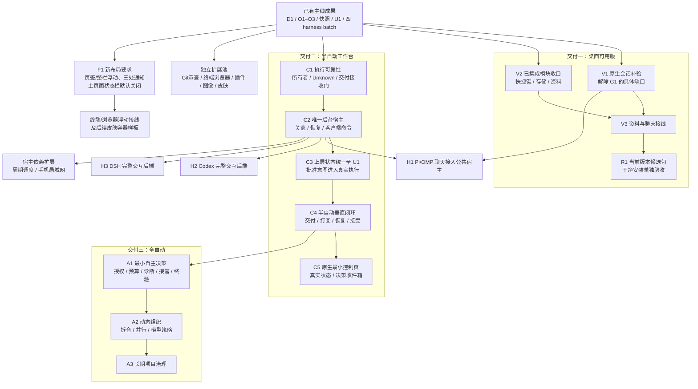

# Fufucode 开发拓扑 v3：功能优先·大包推进·延后集中验收

## 0. 用户战略重构指令（2026-10-14）

> **用户核心决策**：
> “更改一下现在的任务拓扑，重构后续的开发计划：一个派发任务线程做更多功能（同样的难度也会提高，模型需要派发更强或者弱模型要派发max思考强度），减少自测次数，优先完成功能延后测试和交付这一部份工作。我更希望看到更多我的需要的功能先落地。”

### 核心转型战略
1. **大任务包垂直整合（Feature-Complete Mega-Packages）**：
   - 废除将单一功能切碎为“数据层→服务层→测试桩→反例→独立接线→打回重做”的碎片化流程。
   - 任务包垂直贯通：单包直接交付【底层逻辑 + 持久化 + Avalonia 界面 + 设置面板集成】。
2. **升级执行模型与最大思考强度**：
   - 任务难度整体提升至 L3 / L4。
   - 疑难攻坚/全功能大包优先派发 A/S 级模型（`group/auto-hy4-preview-f`、`group/auto-claude-opus-5-5`、`group/auto-gpt-6-astra`）。
   - 主力实现模型（`group/auto-deepseek-v4-1-flash`）**必须显式要求 `max` 思考强度**，禁止低思考强度运行。
   - 免费测试模型退出主开发链路，仅在阶段集中验收时使用。
3. **减少自测频次·延后集中大验收**：
   - 功能开发过程中：以 `dotnet build` 编译 0 警告 0 错误 + 核心冒烟为准，即可收编。
   - 严禁每步都跑耗时数分钟的 1480 断言与重复原生 UI 测试。
   - 全量回归、安装包制作与系统级原生验收延后至**阶段大里程碑收尾时统一集中进行**。
4. **六大核心功能落地路线图（用户刚需优先）**：
   - **【B1】内置浏览器全能对标 & Agent 浏览器控制 (Browser Use & CDP)**：
    - 对标 Codex Desktop 内部原生控制范式（区别于 Playwright 无头自动化与外部扩展插件），基于 WebView2 原生 CDP (`CoreWebView2.CallDevToolsProtocolMethodAsync`) 桥接，暴露标准 Agent Browser Use 工具集（navigate/click/type/evaluate/get_dom/screenshot）。
    - 设置面板增加【浏览器】一级分类（对标 ChatGPT/Codex 设置页：Browser Use 总开关、URL 打开路由策略、清除浏览数据/缓存/Cookie、CDP 开发者权限、智能体权限表）。
    - 工具栏集成 DOM 元素拾取工具（Inspect Tool），支持将网页元素/文本一键引用至聊天输入框。
    - **配套立项【B2】外部浏览器扩展插件开发计划**：通过 Native Messaging / WebSocket 桥接控制外部 Chrome/Edge/Firefox，满足跨浏览器需求。
   - **【S2】设置面板三级架构重构 & 侧栏条目治理 (D2 + D3)**：
    - 设置侧栏三级架构：一级【基础类】（外观/关于/网络/键盘/模型/储存）+ 一级【大功能】（浏览器/终端/文件管理/自动开发，各自有多个专属子配置）+ 一级【其他】（收纳二级小功能：通知/配置/用量/辅助工具）。
    - 支持交互式升降级：小功能可从“其他”升级到一级侧栏，大功能可降级收纳进“其他”，层级偏好持久化保存；每个设置页底部提供“相关设置”关联跳转。
    - 侧栏条目治理：通知与用量等小功能默认移出侧栏；**文件预览撤销独立页签**，做成内嵌能力（在对话、文件列表、资料库中点击任何文件直接预览，支持分屏与全屏切换）。
   - **【T1】底部终端深度优化 & ConPTY / IME 增强**：
    - 终端丝滑焦点获取、中文输入法（IME）无损回显、剪贴板快捷键与右键复制粘贴、历史命令平滑导航。
   - **【M1】手机局域网远程控制 (WorkBuddy 架构对标)**：
    - Fufucode 内置轻量局域网 HTTP/WebSocket 服务，界面 1:1 对标 WorkBuddy 移动端版式，通过 URL 和二维码扫码即连（PWA 形式，免装独立 App）。
    - 增加 **4 位数 PIN 码安全配对认证**，防止局域网设备未授权访问。支持手机端实时查看流式消息、发送指令、审批工具调用与一键中断。
  - **【P1】多核心后端矩阵与一键切换**：
    - 采用方案 B：在设置中指定全局默认后端内核，主界面新建会话直接使用默认，会话卡片与标题带有后端徽标（Badge），支持便捷切换。
    - 内核阵容覆盖：**Pi 官方内核**、**OMP 核心**、**Codex Harness**、**DSH (DeepSeek Harness)**。
    - **远期路线图立项**：**全 C# 原生 Agent 内核**（消除外部 Node.js/Python 运行时依赖）。
   - **【K1】全套皮肤深度视觉资产化与美化重构 (D1 + 前端风格.md)**：
    - 按照《前端风格.md》为每套皮肤（Fluent 2 / Metro / Material 3 / Aero / Luna）建立独立完整的视觉资产表（图标、窗体阴影、圆角、控件模板），彻底剔除各非 Fluent 皮肤中的 Fluent 视觉残余。
    - 收敛各类堆砌的文字说明，以极简卡片、悬浮浮层与辅助图标重构界面品味。

---

2026-10-14第69轮事实：Aero第四可选皮肤已由M公共接线，App1480/公共91/模块169/caption43/引擎121绿及App/solution0警告错误，实际亮暗主窗已核。NATIVE R4仍原免费模型验冻结e3cc78a，不能覆盖本轮Aero；后续原生补验待串行槽。新源候选安装、用户视觉和完整生产门仍待；不据下文旧Aero教师/模块状态重派。

2026-10-14最新事实：E7教师/ENGINE已独立接受收编，M公共接线SHA7deef34974fb1af0b1c6723d8587f0aa13a3b1b3，Fluent/Metro/Material3成为设置可选项并同步浮动窗口。最终App1406零失败/solution0警告错误，仍非原生/安装/完整皮肤终验。后继E7-AERO按hourly-E7-aero-module有限资源控件包由低成本DeepSeek实现，M公共接线；原教师不继续贵模型普通实现。旧“inProgress”以具体台账/新integration记录为准，不重派原两包。

2026-10-13用户最新优先级：**E7皮肤提到当前并行线**，无需等插件异常恢复/完整安装门结束。有已接受S1，分E7-DESIGN（group/auto-claude-opus-5-5有限设计教师，Vista/Aero关键HTML/迁移样板＋参考书）与E7-ENGINE（group/auto-deepseek-v4-1-flash独立Avalonia资源/控件模块，先Fluent机制与Metro/M3可选皮肤）。两包路径分离、最多两个执行者；M唯一接Settings/MainWindow/Appearance与浮动window。默认Fluent保留，新默认视觉选择与原生终验仍另门，不把“等待用户选默认”误作所有换肤工作不开工。完整任务书hourly-E7-design-teacher/hourly-E7-skin-engine，创建身份以台账为准；旧S1保持，不重复派发。

2026-10-13本地/2026-10-14 UTC第57轮：插件安全应用后页面连续性修复集成6b87b73，应用/更新/失败恢复/回退四红后保重接时实际当前页，维护中新导航不串。39实际插件/33取消切页、App1388零失败、服务166/proof21/UI46、solution0警告错误；两尺寸原扩展页无工装重开M已看。正常返回登记与可见结果路径收口，unknown无证据/系统原生/当前源安装/完整E3和生产六门pending。原worker停写无新卡/重派，未知Sandbox不动；Core/Pi本轮未改未重跑，不以旧门冒充本轮。

2026-10-14 UTC第56轮：正常已返回插件原登记的有限恢复已集成bddf39f；原调用实际持有锁已结束、结构化原返回/退出、同会话未加载/空闲排他维护及目录CAS后，仅明确结束单token登记，独立历史保留，不合成应用成功。新47规则/页面和34真实Pi通过，App1388零失败/Core366+1SKIP/Pi48、27取消/166服务/21proof/46UI、solution0警告错误。两尺寸实际挂树动作M已看；未知/旧无证据/取消抛错、跨进程崩溃/原生/当前源安装与生产六门pending。R1/E3仍停写旧确认，无新卡或重派，未知Sandbox门保持。

2026-10-14 UTC第55轮：原插件请求/已观察RPC退出关联集成e5db4c9，Core保关闭事实、宿主固定原coordinator并核generation，原记录/旧字段兼容与保护保持。真实红后7 Core/12 App/4实际Pi新检查绿，Core366+1SKIP/Pi48/App1341、19插件/27取消、166服务/21proof/46UI及solution0警告错误通过。实际异常持有者/有限恢复/原生/当前源安装和生产六门pending；单旧进程退出不自动解除保护。R1 idle/:13只是旧completed确认，无新交付；E3停写、未知Sandbox安装门保持。

2026-10-14 UTC第54轮：Pi停止/释放屏障已集成eb710d6；真实仍活着子进程五红后，共享等待实际退出，保generation/PID/退出码，混合Dispose不提前关句柄。Pi全量48（新增26屏障+1真实退出）/Core359+1SKIP/App1329、15插件/27取消及solution0警告错误全部通过。单个Pi退出不是原插件持有者/所有副作用终止凭证；原请求持久关联、安全释放/崩溃恢复/原生/当前源安装与生产六门仍pending。原R1/E3停写无新卡，未知Sandbox安装门保持。

2026-10-14 UTC第53轮：E3回调返回事实独立原子记录已集成02ba53c，目录提交被真实锁阻断时仍可按原token/version/time/宿主上下文重开核对。原红后24新/原102、15真实Pi/166服务/21proof/46UI、App1329零失败及solution0警告错误；两尺寸图已看。Task返回不证明引擎终止，不改原回执/选定/保护或重发；实际终止/崩溃安全释放/原生/当前源安装及生产六门pending。R1/E3停写无新卡，未知Sandbox安装门保持。

2026-10-14 UTC第52轮：E3无回执的未结束请求现可按原token只读核对，集成13b331a；原页缺口先红，32新检查/原52+18、App1305零失败、14真实Pi/166服务/21proof/46UI及solution0警告错误通过，两尺寸帧已看。只读观察不等于原回调终止，不释放保护或合成回执；实际崩溃安全释放先补请求级持有者/宿主证据。原生/当前源安装及生产六门pending，R1/E3停写无新卡，未知Sandbox冻结安装门保持。

2026-10-13第51轮：E3结果视口缺陷已修并集成82a2406，延迟滚动反例先红，原核对按钮/结果置于历史详情前；原详情可滚动复制。18回执+14真实Pi/46UI、App1273零失败/solution0警告错误；M实际两尺寸PNG确认结果完整，E3-RECEIPT-PIXEL-1仅无头像素边界verified。原生/残留在途明确释放/当前源安装及生产六门仍待，内部滚动触发源未证明；原R1/E3停写无新卡，未知Sandbox冻结安装门保持，不重派。

2026-10-13第50轮：E3原回执历史/精确token只读加载核对已集成52a8f3c，不改原unknown/选定、无重发/保护释放。15默认回执+14真实Pi检查、App1270零失败/Core359+1SKIP/Pi21/solution0警告错误通过。结果面板几何/绑定绿但捕获像素未见，E3-RECEIPT-PIXEL-1 open，下步M优先排查，不称视觉/原生或生产六门已验。R1/E3停写无新卡，未知Sandbox安装门保持。

2026-10-13第49轮：E3提交前迟到取消/关闭已修并集成4a9e034；真实Resume后取消不再发布未接受的候选，释放实际候选、保旧配置供明确恢复。四红后27取消/关闭检查和原12安全切换绿，App1255零失败/Core359+1SKIP/Pi21/solution0警告错误。提交后取消/unknown核对/原生/当前源安装仍pending，原R1/E3均停写，无新交付/重派，未知Sandbox门保持。

2026-10-13第48轮：E3取消/关闭增量已集成92abe05，预取消保原Pi、初始化取消还原旧加载配置、结束进度提供明确恢复、Apply/Dispose同门。真实五红后18取消/信任/重复请求与原12安全切换绿；App1255零失败/Core359+1SKIP/Pi21/solution0警告错误。晚成功关闭/unknown回执核对/原生/本源安装仍pending，工具无node_repl不冒充原生；未知Sandbox与R1冻结源保持，无重派。

2026-10-13第47轮：启动未选项目/失败时的本地插件入口已公共集成08a1e69，原模块同控件/VM/目录复用，明确返回与重试互斥；29新默认断言、原共享23、12真实Pi外壳及App1255零失败/solution0警告错误/Core359+1SKIP/Pi21通过。插件原生/长任务取消/当前源包与生产六门继续pending；原R1/E3停写，无新卡/重派，未知Sandbox安装门保持defer。

2026-10-13第46轮：E3真实Pi安全应用/更新/回退已公共接线，19真实宿主与8共享外壳路径通过，35proof/166服务+21规则/46无头UI；最终Core359/Pi21/solution0警告错误，App1226零失败。失败候选实际恢复旧版后外壳失联红→重接Chat绿；Core运行态门另忠实反例红/恢复绿，并不解锁原生IME/DPI/生产安装整项，启动失败离线入口仍待做。R1冻cc44eee不含后续，未知Sandbox安装阻塞保持，不重复派工。

2026-10-13第45轮：R1新候选正式交付4097328，M源/三产物/ZIP15542/三份1203零失败原日志及CLI核验通过；新版setup安装未运行，未知Sandbox占槽，defer而非整项验收。E3真实Pi初始化证明首增量最终35实际/规则、默认21规则及166服务通过，App全量1226零失败/构建0警告错误；no-await忠实红/恢复绿保留。尚未接桌面安全应用/回退；M继续原重启链公共接线，不把proof或离线副本当完整插件可用。当前生产范围/六门仍未齐。

2026-10-13第44轮：E3模块已导入并接现有扩展页的离线副本管理，23共享断言/166服务/46无头UI、solution Release零警告错误及最终App全量1226零失败通过；真实Pi安全应用/实际加载/回退尚未接，不能解锁插件整项验收。R1仍原会话冻结cc44eee构建同包三轮/干净安装，不加入后续E3，当前在运行没有最终审核；最新M结果及提交见M-E3-offline-integration记录，下一M自做L4任务hourly-E3-pi-host-wiring。

2026-10-13继续轮实际公共实现SHA cc44eeef02c84c82847e104d31186a08f3d3c6a1；原R1 qf/cb9f现已同会话新turn01a13623执行R1-REVALIDATE，只导入冻结八路径并新包/干净安装复验。旧4de5151两包与当前源分开，未有新包最终验收；E3模块接受pending_wiring不进入这次冻结源。Hosting267本轮通过，其他最终计数如上，六门/全范围继续未完。

2026-10-13第43继续轮：只读刷新清焦点与连接切换已产品修复，最终Release三全量各1203零失败、Core349/Pi21、solution零警告错误；CLI显式后台宿主入口源码/发布物生命周期通过。纠正Hosting/Control是Core命名空间，不必独立DLL。E3最终8c67289模块接受pending_wiring（166服务/十反例），公共Pi/页未接。M提交新固定源后原R1按hourly-R1-after-focus-revalidation有限逐字导入八路径重建，旧4de5151两包证据不改变，不称新安装验收完成。

2026-10-13第42轮R1正式停写卡a99693c已审核：六产物与两ZIP各15542摘要M实际匹配，两份Sandbox12/12证据已读；包内不稳定自测/缺Host载荷由M公共修复，defer/not_integrated，保候选与原树。既有含“仍运行”的记录为当时状态；冻结4de5151不改，未宣称六门/全范围完成，E3原第二返工继续。

2026-10-13第42轮：E3第一修复轮200a36a，M服务125与原五反例通过；新增四断言FAIL，E3-local-review-rework2决定原线程L3继续修三邻接不变量，not_integrated，公共接线仍M所有。R1原会话仍inProgress，4de5151冻结源不改、没有当前包正式验收，保留两槽与原生串行门。

2026-10-13第41轮：E3-LOCAL正式停写交付21eebc5，M独立服务81通过、额外五反例失败；按E3-local-review-rework-2026-10-13.json打回原L3/原deepseek线程，not_integrated。公共接线缺失不是打回理由，四行为缺陷修复后再审。R1候选仍在执行，冻结4de5151、不包含插件，不将中途绿色或焦点根因猜测当生产验收。

2026-10-13 用户继续指令：E3-LOCAL作为第二槽独立实现，与R1当前候选包装并行；现有启停/加载状态保留，新增Pi本地固定版本副本、兼容/来源、更新失败恢复与回退组件，公共扩展页与安全重启接线归M。真实身份见records/E3-local-dispatch-2026-10-13.json，task_started已观察但实时监督API故障，未交付/验收。R1冻结旧来源不追溯包含插件成果；H1/手机依赖和皮肤产品选择不越门。

当前版本交付路线：R1-REFRESH已创建为隔离执行会话，产品固定4de5151（含C5第七增量），旧e64dd1b包保留。状态inProgress，新的包/安装/生产验收没有结论；当前C5系统原生缺项继续单独记录，不阻止可独立的候选构建。真实thread/tree与防重建身份见records/R1-refresh-dispatch-2026-10-12.json，任务范围hourly-R1-refresh-candidate.md。

第七增量实际产品mainSHA `c417db8c62c8192874f7685419baae96099213c9`；失效待办旧输入保留已集成，完整C5/生产门继续待验。

2026-10-12继续轮（用户时区）：C5第七增量修复后台变化清空最新输入，旧版本决定禁用但输入可只读复制/明确保存，项目切换不串稿。新增9项，最终App1198/C5 194零失败、标准solution0警告错误。验收限该App增量，系统IME/DPI/跨进程长稳/新候选包仍待；记录M-C5-invalidated-input-2026-10-12，真实SHA提交后补录。

第六增量实际产品mainSHA `794e3380e7837baa53bca3555e6f6f05e83ee94a`，已集成明确保存/恢复与只读原回执核对；完整C5和生产门继续待验。

2026-10-13 C5第六增量：最终持久化模块已收编f6a52b1，M公共原生手动草稿保存/恢复、owner稳定身份、十种原命令记录与只读unknown回执核对已接并全量验证。App1189/C5 185零失败，Control511/Hosting267/Core340/Pi21/持久化192及标准solution0警告错误。真实公共SHA提交后补录，见M-C5-persistence-integration-2026-10-13；原生IME-DPI/跨进程长稳/新包仍未验，不把增量或模块接受写成C5整项/生产六门完成。

第五增量实际产品mainSHA `470c8cd91a610b202ccd0e0b6ea07fe410413db5`，仅取消后明确Interrupted路径已集成；C5-PERSIST仍新返工，公共草稿/请求恢复未接。主线App1168/C5 164零失败及相关回归见M-C5-stop-resolution-2026-10-13。

第五增量最终App1168/C5 164（新增35）零失败，solution0警告错误、Control511/Hosting267/Core340/Pi21通过。取消Unknown已提供明确Interrupted出口，原文件/session/无settle HEAD保持，不启动恢复/认证完成。Windows路径反例已修，按键与PID复用根因项保持open。C5-PERSIST新返工仍active，正式卡前不收编，随后公共草稿/原请求接线；真实mainSHA验后补录。

2026-10-13 C5第五增量推进取消后的人工Interrupted对账，同身份/CAS与真实进程/Git门，禁止假成功/自动恢复。持久化166+原五反例修复已核，但新opaque身份/null版本四反例失败，最新原L3会话rework、尚未收编；M独立对账路线继续。最终证据及SHA见M-C5-stop-resolution-2026-10-13，仍非C5整项/生产六门完成。

第四增量实际产品mainSHA `7861b77fb03cfbe31ddad953f87c9fccb73ded88`，仅C5单次取消接线已集成；持久化返工未集成。证据见M-C5-stop-2026-10-13，SHA补录不改变测试对应源码。

2026-10-13 C5第四增量：明确取消单次执行已接原唯一Host及身份/CAS/持久原回执，Unknown需对账而非假成功；App1133/C5 129、Control511/Hosting267/Core340/Pi21和零警告错误构建。持久化模块停写卡已独立核查，原135通过但新增5反例失败，四项finding原L3会话返工/not_integrated。后续公共草稿接线、取消Unknown明确恢复与原生输入/生产宿主另验；PID复用保守阻断仍open，不放宽安全门或宣称C5整项完成。

2026-10-11。核对基线 `main@61984e0`。本文件是新的开发顺序与任务边界真源，替代旧 D/O/U 图作为新派工依据；旧编号用于追溯，不删除既有任务书、会话、工作树或审核历史。

机器可读计划：[development-topology-v2.json](../automation/development-topology-v2.json)。它是版本化规划，不是运行状态，也不是旧门房可直接消费的 plan.json。实际新派发须经任务登记与唯一执行入口；本次重排没有启动新 worker、暂停旧门房或强行续接未知会话。

## 1. 当前事实与停滞原因

这是“已有可用基础，多个模块待验收，自动化尚未接成产品”，不能用一个总百分比描述。

| 成果 | 主线事实 | 尚缺 |
|---|---|---|
| 桌面基础、Pi 会话与打包 | 已有应用及 1.4.1 打包记录 | 新增功能对应的新构建与验收；旧包不是当前 HEAD 的发布证据 |
| D1 Pi/OMP | 已整合；真实引擎协议、审批、停止、恢复测试有记录 | G1 原生拒绝/停止等补验；不是重做双后端 |
| O1 快捷键、O2 存储、O3 资料 | 已整合并接入口，定向行为测试有记录 | 原生交互验收；资料与真实聊天的引用接线 |
| D4-SNAPSHOT | 已整合，31 项检查 | 工作树操作和本地审查消费端；不是整项 D4 已完成 |
| U1 持久控制 | 已整合，身份、审核、事件、依赖等测试通过 | 唯一后台写入、跨宿主资源协调和控制意图接线 |
| 通用 harness 执行 | `61984e0`；四后端 batch 两轮恢复、重放已测 | 常驻托管、Unknown 受控恢复、交付接收门、交互后端 |
| 半自动控制台 | `f29ebb0`；规则与 HTML 有测试 | 当前独立 JSON 状态需迁入 U1；待执行意图尚无真实消费者 |
| U3 原生图 | 来源 `b23120e`，未集成，第三轮 rework | 点击模板身份、Canvas 布局、部分选择三项具体缺陷；原需求也已更新 |
| M0 / S1 | 手机和皮肤原型已收编 | 手机服务/真机与正式皮肤选择、生产接入 |
| D0 | 格式修正有效，审核 blocked；不需要代码返工 | 干净安装环境与实际安装/启动/卸载证据 |
| O6-RULES | worker 失败，无可信交付；工作树有未跟踪源码与测试 | 先核对、保存并评估残留，再决定收编范围；不得覆盖 |

证据入口：[D1](../records/M-D1-acceptance-2026-10-10.md)、[O1](../records/M-O1-integration-2026-10-10.md)、[O2](../records/M-O2-integration-2026-10-10.md)、[O3](../records/M-O3-integration-2026-10-10.md)、[D4](../records/D4-git-snapshot.md)、[U1](../records/U1-delivery.md)、[通用后端](../records/harness-backend-2026-10-11.md)、[半自动](../records/parallel-upper-control-2026-10-11.md)。这些是已有验证记录，本次没有重新执行产品验收。

旧计划现场问题：

1. G1 为 open，却没有一个独立可执行的“补验 G1”节点；大量下游只会等待。
2. G1 同时阻塞终端、浏览器、Git、宿主等工作，混淆“允许独立实现”和“允许接入生产”。
3. R 要求 D6 手机、O7 图像、S2 皮肤、U2/U3 等全部完成，把独立扩展捆成一次发布。
4. U3 返工次数耗尽后没有诊断与范围重定任务；继续相同 prompt 不能解除阻塞。
5. 旧脚本、HTML reducer、Core/U1 已形成多条未连通链路；继续增加控制台功能会放大接线成本。
6. `blocked-M0.json` 与 `done-M0.json` 同时存在，不能只凭阻塞文件计数；需按真实集成决定解释状态。

现场旧 workflow 状态为 waiting_events，gate/workflow 进程存在，固定 M 最近记录为 ready。监听进程存在不表示模型正在开发，也不表示关键路径能继续。

## 2. 新推进方式

2026-10-11 后续授权：工作台完成前，采用[本线程每小时推进](hourly-main-coordination.md)，创建 Codex 独立执行会话并按较大任务包交付。下文“不恢复定时模型轮询”是此前策略，由此临时安排替代；旧 15 分钟循环不恢复，旧调度须先完成单写入者交接。

产品开发由当前主 agent 直接推进，受限独立任务可临时委派。未完成的自动控制台不再成为开发 Fufucode 的前提。机械检查由代码执行，复杂审核按需要调用智能能力，不恢复定时模型轮询。

先保持最多两条开发线：一条产品收口、一条后台控制。共享 Core/App 入口只允许一个集成写入者；路径重叠时串行，不为了并行数量创建线程。任务 ID 与逻辑分组不是已启动的会话。

每个增量采用：明确用户路径 → 实现/修复 → 定向验证 → 集成 → 验证该路径。避免先做很多独立模块，再统一等待“最后接线”。

三个可交付里程碑：

- **桌面可用版**：已有聊天、审批、停止、恢复，以及快捷键/存储/资料能实际使用；保留现有风格，不等新皮肤、手机和自动化完成。
- **半自动工作台版**：一次人类批准能驱动真实任务、交付、局部打回、原会话恢复和接受；界面显示同一权威状态。
- **全自动版**：在上述同一闭环中增加受委托决策、预算、诊断、人工接管和项目验收；先单执行者，再动态并行。

这些是阶段交付，不删原需求；最终完整范围仍包括四后端交互、各扩展与后续体验。

## 3. 新总图

图中 V2 的“独立页面验证”不依赖 G1；V3 的真实聊天接线仍要求 V1。C1/C2 可以独立实现和隔离测试，不因原生 UI 补验停工；Pi/OMP 桌面会话迁入新宿主必须同时通过 V1 与 C2，既有安全要求没有被删掉。

## 4. 首轮任务包

| ID / 难度 | 范围与所有权 | 完成条件 | 依赖 |
|---|---|---|---|
| V1 / L3 | D1 原生补验、必要的局部缺陷修复；主 agent 负责 Core/App 共享入口 | Pi/OMP 拒绝无写入、停止无后续执行、再次发送、取消选择、缺失后端失败返回；记录精确构建与证据，明确 G1 结论 | 已有 D1 |
| V2 / L3 | O1/O2/O3 已集成页面；不扩展成新模块 | 实际快捷键编辑生效、存储临时数据预览/清理保护、资料导入搜索引用复制；原生焦点/缩放必需场景 | 已有 O1/O2/O3 |
| V3 / L3 | 资料引用与真实聊天消费，公共接线由主 agent 串行 | 从资料选中内容到正确会话引用，来源与文本一致，后端缺失/会话切换不误投递 | V1、V2 |
| R1 / L3 | 对 V1–V3 固定 HEAD 打包，继承 D0 成果 | 包内路径启动与恢复通过；干净安装/升级/卸载单独出证据，无环境时只交候选包 | V3 |
| C1 / L4 | Core/Automation/Harnesses 与独立测试；不修改生产旧队列 | 运行所有者/子写入者核对；Unknown 有受控解决路径；投递与状态/事件一致；真实 HEAD 与交付身份校验；重复、丢回执、重启不多派 | 已有 U1 与 batch |
| C2 / L4 | 新后台宿主、客户端契约；统一写入者，不另造第二调度器 | 关闭 CLI/UI 后继续；重连补事件；重启积压恢复；不明投递不重发；退出与停止行为可解释 | C1 |
| C3 / L4 | 把半自动规则迁入 U1/公共控制入口；Python/HTML 变客户端 | 工作包/决定/意图/事件同权威事务；旧 JSON 只受控导入/导出；幂等命令、过期拒绝；人工登记不伪造执行报告 | C2 |
| C4 / L4 | 最小真实任务纵向接线，不先扩展图编辑器 | 两个任务积压、人类串行裁决、局部打回、原模型/原会话修复、接受不等于集成；受控集成后独立验证；空闲零模型 | C3 |
| C5 / L3 | 原生控制 tab；先只读状态与必需决定，再图操作 | 一个入口读取 C4 状态；总览/展开/运行中筛选；节点点击/布局/部分身份真实可用；不展示虚构运行 | C4，U3 候选复核 |

V1 若缺原生操作工具，记录具体缺口并继续 C1/V2 可独立部分，不把工具缺失标通过。R1 的干净环境阻塞不阻止继续交付可运行候选包，也不把候选包标正式安装验收完成。

新派独立实现任务优先明确建议 `group/auto-qfmodel`，复杂公共契约由当前主 agent 承担，不额外启动昂贵 lead；新 prompt 仍须按当前 canonical 能力评估。既有打回沿用原模型/会话；所有机制模型试跑显式 `devin/swe-2`。本表不是自动换模型授权。

## 5. 扩展池与依赖

| ID | 承接范围 | 真正依赖 / 发布边界 |
|---|---|---|
| H1 | Pi/OMP 桌面接公共宿主，旧 D5 客户端接线 | V1+C2；通过后才替代旧会话所有者 |
| H2 | Codex app-server 交互后端 | C2；独立后端审批/停止/恢复验收，不要求 DSH 同时完成 |
| H3 | DSH 原生交互后端 | C2；先验证公开交互接口与能力，不能用 headless 冒充全部聊天能力 |
| E1 | D4 工作树操作与 O4 本地审查 | 快照已可复用；本地操作可独立做，模型审查接已验证执行入口，不泛挂 G1 |
| E2 | D2 终端与 D3 浏览器基础 | 独立控件可推进；接聊天/宿主的功能单独验收；IME/DPI 不免除 |
| F1 | 页签/整辅助栏浮动、旧浮窗迁移、三处通知、默认关闭状态栏 | 用户2026-10-11最新确认，按[floating-workbench](floating-workbench.md)；公共布局M单写，作为E2接线与后续皮肤样板基础，当前候选不回溯改包 |
| E3 | O5 插件管理 | 按各 backend 的真实能力分别验收，不等待四后端插件等价 |
| E4 | O6-RULES、O6 周期调度 | 先收编可用规则残留；生产调度依赖 C2，和自动开发策略分开 |
| E5 | M0、D6 手机局域网 | 复用原型；依赖 H1/C2 的配对、审批身份、断线恢复和真机证据 |
| E6 | O7 图像 | 独立供应商调用与历史，资料收藏依赖 V2；凭据/收费按授权 |
| E7 | S1/S2 正式皮肤，当前优先并行 | 复用S1；教师关键样板与独立Avalonia机制立即推进，可选Metro/M3实现不等更换默认；新默认/视觉终验待选择，Fluent不变，M共享接线 |
| E8 | D8/O8/D9/S3 高级浏览器、PR审查、外网、Luna/Aero等 | 各自基础能力和专项安全/授权门；不要求所有扩展同时完成 |
| A1 | 新架构 P0 | C4；委托、预算、停滞诊断、人工接管、项目验收必须完整，原生图丰富度不是前置 |
| A2 | 新架构 P1 | A1；动态拆合、有限并行、竞争与资源调度 |
| A3 | 新架构 P2 | A2；长期目标与跨阶段知识 |

## 6. 旧任务处置与门禁迁移

所有旧编号在 JSON 的 legacyCoverage 中列出承接者，不能仅把旧节点隐藏后遗忘需求。

- 已整合 D1/O1/O2/O3、D4-SNAPSHOT、U1、M0、S1：复用，不重新派发实现；旧测试只作对应版本证据。
- U3：保留原树 `auto-project-U3`、原 `devin/swe-2` 和三项 finding。先比对新 C5 需求，只修可复用部分；图动画/编辑高级项后置，不能直接接受旧交付或刷新返工计数继续盲跑。
- O6-RULES：保留原树未跟踪内容；E4 先核查其价值与来源，输出保留/需修复清单，再在授权范围内续接。
- D0：保留 blocked 决定，R1 承接环境补验；不是重新要求 worker 改文档凑交付。
- M0 残留 blocked 文件：以已集成证据为准，旧记录不删除；状态投影需排除已解决阻塞。
- G1：拆明为 V1 的原生证明和已有引擎协议证据；不能将 batch 成功替代原生审批证明。
- G2：由 C2/H1 的宿主生命周期证据承接；手机和调度必须满足其适用部分。
- G3/R：拆为 R1、C4/C5、A1 三个阶段验收；最终完整范围验收另汇总，不把阶段通过写成全项目完成。
- Q/V：嵌入每个任务的完成条件，不建立一个永远 pending 的大“统一测试”节点。

旧生产图不原地改写为 v2，避免仍活跃的旧运行引用失效任务身份。切换须由 C3/C4 读取旧 run/review/integration，核对停写和身份，做影子对账，再按单一写入权切换。切换前不得把新图描述成生产调度图已生效。此次不停止旧监听、不恢复 heartbeat、不接管未知会话。

## 7. 下一步执行顺序

2026-10-13 C5第三增量：原生规范/知识/问答/四种关系/单项替代提案已接，App1105/C5 101、Control511/Hosting267/Core340/Pi21、零警告错误构建。修订opaque ID与额外活动writer变更门红绿；C5-PERSIST隔离worker已启动，停写交付后再审与公共接线。生产宿主/系统原生输入、复杂拆合与图编辑/动画仍待，不把新建计划当实际运行或C5整项完成。

2026-10-12 C5第二增量完成已有高级待办的原生发布/拒绝、问答、采用、竞争选择、重组；App1076/C5 72、Control511/Core340/Pi21及零警告错误构建。保留同权威身份与分离的发布/采用/运行/集成门；创建提案入口、恢复、生产宿主及系统原生输入仍待。见M-C5-decisions-2026-10-12；C4已解锁的A1独立工作不必等待图动画/编辑丰富度。

2026-10-12 C5第一增量已接原生tab与主要身份决定；App1045/C5 41、Control511/Hosting267/Core340/Pi21及零警告错误构建。原U3三缺陷由新页面实际回调/Arrange/部分入口验证，不直接接受旧卡。继续高级待办/事件恢复与原生输入，未完成C5整项/生产全自动；见hourly-C5-native与M-C5-native-2026-10-12。

1. 当前主 agent 首先推进 **V1**，明确关掉或定位 G1 的剩余缺口，禁止重开整个 D1。
2. 可独立推进 **C1**；它直接补当前通用适配层的恢复和交付边界，不等待控制台 UI。
3. **V2 → V3 → R1** 收口已有桌面成果，尽早交付可体验的固定版本。
4. **C2 → C3 → C4** 接通一个真实半自动闭环，再做 **C5** 的最小原生页面。
5. 根据使用反馈进入 **A1**；E 系列按实际价值逐个拉取，不一次铺开所有线程。

每次集成后更新真实成果和下一就绪项。失败先明确归属与新证据，再决定修复；不单靠次数上限把项目长期留在 waiting，也不无限加重试次数。

2026-10-12 C4最小纵向路径通过：真实Codex/devin/swe-2双任务、原session部分返工、接受/独立Git明确授权集成59检查，Control511/Hosting267/App996及零警告错误构建。范围为受信本机部署和临时U1/Git，非生产全自动/四harness整体验收。下一就绪C5原生最小控制tab读同权威库，生产服务/Unknown失败路线/IME/DPI另验；见hourly-C4-vertical与M-C4-vertical-2026-10-12。
