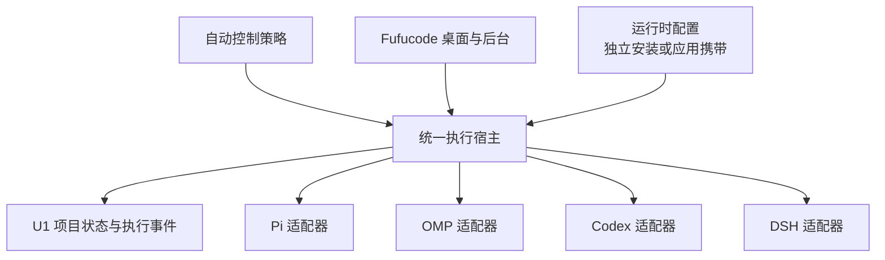

# 通用 Harness 执行后端

2026-10-11。对应 [上层控制架构](../design/autonomous-development-control.md) 的执行适配，不另建 AUTO 决策系统。

## 结构与复用



协议与部署分离：`HarnessRuntime` 提供绝对可执行路径、参数数组、版本和环境；`IHarnessAdapter` 解释原生协议。代码中没有本机用户名、固定安装目录或默认模型。CLI 宿主和未来应用宿主调用同一 `HarnessExecutor`，不复制调度逻辑。

因此，不需要先完成 Codex/DSH 的 Avalonia 聊天界面才能接入自动执行。这里的 batch 适配先实现有界任务调用；完整聊天后端仍需历史映射、流式交互、工具审批、优雅中断等能力，不能把本增量当成完整桌面后端。现有 Pi/OMP RPC 会话继续保留；后续可在同一控制层下扩展 RPC/app-server 适配，不能同时拥有同一会话。

## 首批适配

| Harness | 本增量机器入口 | 原会话续接 | 模型绑定 |
|---|---|---|---|
| Pi | print + JSONL | 精确 session 文件 | 显式 model，可指定 provider |
| OMP | print + JSONL | 精确 resume 文件；识别标题前缀 | model 与 smol/slow/plan 显式相同，可指定 provider |
| Codex | exec + JSONL | exec resume 精确 thread ID | 显式 model，workspace-write，approval never |
| DSH | headless + JSONL | 精确 session-id | 单次 Cordis overlay 指定 provider/model，禁用模型标题生成 |

DSH 的 Cordis 是插件生命周期核心，不是与 Pi 共用的 RPC。不能只更换二进制名称。Codex 的非交互入口依据 [官方说明](https://developers.openai.com/codex/noninteractive) 与本机 help；DSH 的选模和事件结构依据已安装 0.2.0-rc.2 的 headless、agent-default-model 及 Cordis patch 源码。

当前能力表明确不支持 interactive approval、graceful cancel、attach running。取消为终止本次拥有的进程树并记录 Unknown，不能伪装成原生安全中断。不会自动接管已有用户会话，不使用 last/模糊会话选择。

## 状态与安全边界

- 复用 U1 项目 SQLite，追加 `harness_bindings`、`harness_runs` 执行日志，事件进入既有 `automation_events`。
- 先持久记录 Dispatching，再启动进程。相同运行 ID 和相同输入返回旧结果；相同 ID 不同输入拒绝。
- 同一项目数据库内，同一线程或工作树只能有一个 Dispatching/Running/Unknown。所有调用入口必须使用同一项目数据库；本约束不锁住未知外部用户进程或另一份数据库。
- 原线程绑定 runtime、版本、模型、provider、工作树和保存会话；改变绑定需要显式迁移，不静默创建新会话代替恢复。
- 机器终态、进程退出和真实会话身份共同决定执行结果。退出码 0 不是交付接受，文字“完成”不是终态。
- 投递后坏流、会话身份改变、超时或缺少终态均不能触发自动重发。状态查询对丢失所有者的运行报告 Unknown，但不擅自更改仍可能活跃的进程状态。
- 本增量没有自动解除 Unknown 的入口。恢复必须先核对真实进程和保存证据，再实现受控恢复协议；不能直接改数据库后重跑。
- 接受、集成和项目验收继续由上层契约管理。stdout 内容只是执行成果，不直接构造可信 delivery 或自动 accept；HEAD、工作树洁净度和交付身份检查仍是接收门责任。
- 单行与总事件输出有上限，stderr 截断后继续排空避免堵塞。原生日志可能含项目内容，保留在本地证据目录，不自动公开。

## CLI 入口

构建：

```powershell
dotnet build C:/Projects/Fucode/Fufucode/tools/Fufucode.HarnessHost/Fufucode.HarnessHost.csproj
```

宿主接收绝对路径的本地 manifest：

```json
{
  "Database": "C:/my-project-state/automation.db",
  "EvidenceDirectory": "C:/my-project-state/evidence",
  "Worktree": "C:/my-owned-worktree",
  "ProjectId": "example",
  "BaseSha": "actual-base-commit",
  "TimeoutSeconds": 120,
  "Runtime": {
    "Id": "configured-codex", "Harness": "codex",
    "Executable": "C:/runtime/node.exe",
    "PrefixArguments": ["C:/runtime/codex/bin/codex.js"],
    "Version": "verified-installed-version"
  },
  "Request": {
    "RunId": "unique-run-1", "ThreadId": "owned-thread", "TaskId": "owned-task",
    "Model": "devin/swe-2", "Prompt": "Reply only HELLO. Do not use tools or delegate."
  }
}
```

示例路径必须替换。版本字段记录本机核实的版本，并非自动探测结果。凭据通过已有受信运行环境提供，不放入任务提示词或公开记录。

```powershell
& C:/Projects/Fucode/Fufucode/tools/Fufucode.HarnessHost/bin/Debug/net10.0/Fufucode.HarnessHost.exe register C:/my-project-state/run.json
& C:/Projects/Fucode/Fufucode/tools/Fufucode.HarnessHost/bin/Debug/net10.0/Fufucode.HarnessHost.exe run C:/my-project-state/run.json
& C:/Projects/Fucode/Fufucode/tools/Fufucode.HarnessHost/bin/Debug/net10.0/Fufucode.HarnessHost.exe status C:/my-project-state/run.json
```

register 仅用于显式登记本工具将拥有的新线程/任务，不启动模型。run 是单次调用，不是脱离终端的常驻服务；未来后台宿主接入同一库。窗口关闭、睡眠重启的服务托管、遗留门房迁移和原生 UI 接线不在本增量冒称完成。

## 验证与后续

定向测试项目：`tests/Fufucode.Harness.Tests`。真实模型试跑脚本：`scripts/harness-smoke.py`，要求本地显式 runtime 配置；固定 `devin/swe-2`，临时目录内两轮记忆恢复及重放检查。进程夹具中的人工 review 决定是确定性输入，不是实际审核模型。

下一增量把上层已批准的执行意图接到应用后台唯一执行宿主，并补齐受控恢复、交付接收门和可交互协议。四种 harness 的完整桌面功能按能力逐项接入，不将最低共同能力伪装成全量等价。
