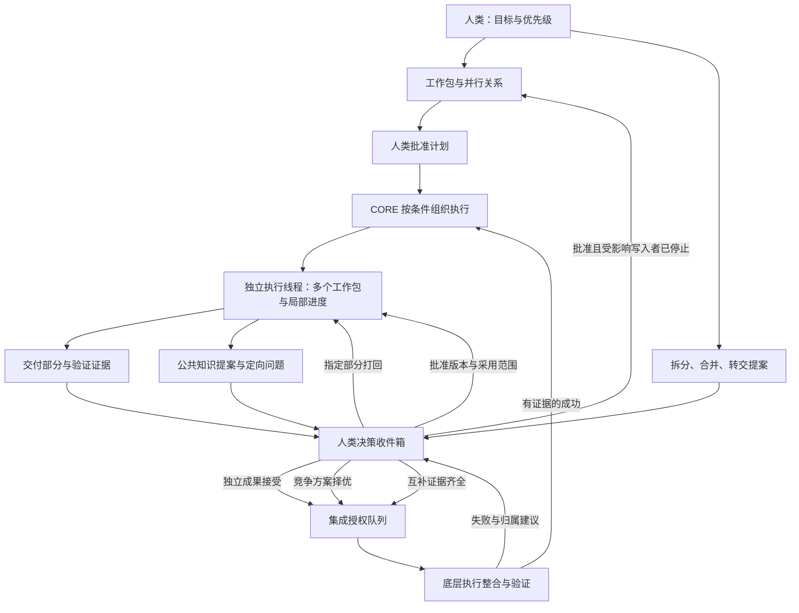

# 三种开发模式与半自动上层控制

> 2026-10-15最新范围：[CONV-AUTO-v4](conversation-workbench-v4.md)取代此文“全人工默认”和旧图表/表单入口。保留已实现的半自动机制与协作证据；新项目默认自动，已有项目显式模式不变。状态实现与产品验收仍须分别举证。

2026-10-11。依据用户粘贴的半自动并行工作台讨论。此文定义半自动上层控制及已实现范围；harness、进程恢复、工作树管理和生产集成适配单独实施。后续确认的三模式共用架构与全自动设计见 [开发控制架构](../design/autonomous-development-control.md)，新自动策略尚未实现。

## 优化后的边界

- 全人工是新工作台默认：用户直接使用执行会话，可以整理工作包；批准计划不产生自动执行意图。
- 半自动：人类保留最终裁决；CORE 按明确批准的计划产生执行意图、汇总成果和决策事项。AI 可辅助建议，不代人批准。模式切换不停止在途工作，也不改现有全自动监督器。
- 全自动：保留模式身份，策略暂不启用；原有自动门控仍用独立入口。禁止把旧“手动编辑”模式冒充全人工开发模式。
- 工作包与线程分开。线程卡可包含多个工作包；未启动的工作包明确显示待分配，不捏造真实对话线程。
- 竞争、互补和依赖不是同一种连线。竞争要求共同基线和评价标准，获选且通过审核者才能进入集成；互补组须证据齐全；流水按集成结果或已验收的证据成果解锁。
- 动态工作包可以跨目录，但拥有明确范围与验收。拆分/合并/转交生成后继ID，保留历史；重组依赖方需要重新批准。已集成成果不通过重组抹除；跨多个协作组重组须进一步定义新关系，不默认合并其语义。
- 活跃写入者只收到停止意图；未有真实停止证据，不应用重组。状态不明必须对账。更换模型是显式后继分配，原模型和保存线程不被覆盖。
- 公共知识区分提案与批准事实。版本和来源必填；声明依赖的执行包收到采用决定，其他工作包不广播打扰。采用后相关旧交付不继续获得集成授权。
- 跨包问题与答复独立记录，不自动提升为公共事实。人工登记与 adapter 报告明确区分；本版没有原线程自动消息投递。
- 人类只读一次明确决策包：目标/标准/版本/成果/证据/选项；接受、选择、批准集成是不同决定。不能从“批准集成”直接写已集成。

## 上层流程

## 已实现入口与范围

- `scripts/parallel_control.py`：无模型、Git、进程调用的上层 reducer；单命令单版本，重放去重与预期版本检查；四种关系、工作包、人类决定、部分打回、重组、契约采用及定向问题。
- `scripts/automation-console.py`：`GET /api/development` 与原受保护 command 入口 `action=development`。HTTP 用户不能提交 execution.report/integration.report 伪造进程或集成结果。
- `docs/frontend-prototype/automation/parallel.html`：默认全人工入口，半自动线程/工作包图、关系组、决策收件箱、工作包提示词、交付登记、重组及公共知识表单。
- 本机演示控制记录 `tmp/development-control/state.json`：原子文件保存、跨进程写锁及命令回执。仅上层工作台存储，不替代 U1 项目 SQLite，不与生产 CLI 状态双写；产品落地时经明确适配迁移到 U1。

尚未接线：自动模型拆包、真实会话/工作树创建回收、执行意图消费、原线程消息投递、语义冲突检测、真实差异与基准比较工具、Avalonia 原生页面。当前仅声明重叠范围/契约的提示，不宣称 AI 语义理解。全自动按新的上层架构分阶段实施，不把架构文档当运行证据。

下层必须提供受信执行报告，并重新核对 commandId/工作包版本、原线程身份、写入停止与证据；不能直接把用户登记的 HEAD 当作真实仓库验证结果。子代理归属执行线程，不作为新的项目决策人。

## 验收

本轮上层验收：默认不自动派发；四类成果处理不混淆；部分打回保留其他部分；活动写入者阻断重组；后继身份和依赖版本正确；公共知识批准与采用分离；旧决定失效；重复命令不重复作用；人类不能伪造适配器终态；重开状态保留；UI 与本机记录一致。全部模型测试如有必要仍显式 devin/swe-2，本轮无需模型。
