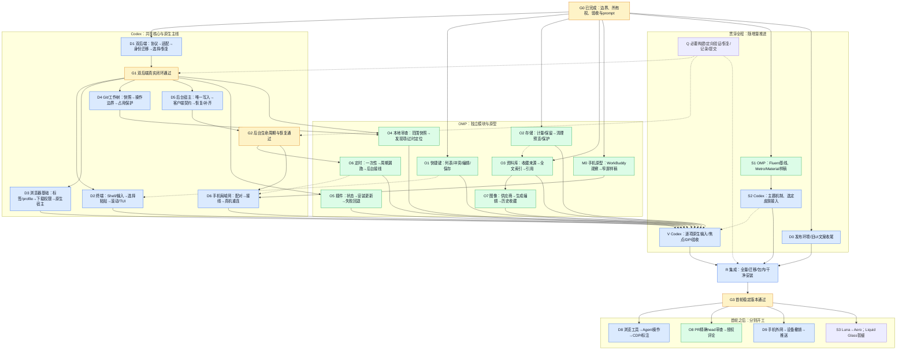

# 下一阶段详细开发图与开工入口

2026-10-11：本页旧图保留追溯。当前开发顺序已重构为 [开发拓扑 v2](../tasks/development-topology-v2.md)：桌面可用版、半自动工作台、全自动分开交付，旧任务都有承接关系。不要依据下文历史“第一批”重复派工；新图尚未自动替换运行中的旧门房计划。

日期：2026-10-10。G0规划步骤已完成；产品实现未开始。用户指定今后按本图开发。实线是必须完成的依赖，虚线是贯穿支持或可提前做的原型；没有依赖的任务可并行，不按视觉位置全部串行。

入口：[边界/所有权/验收](../tasks/execution-contract.md)、[直接发送的prompt](../tasks/launch-prompts.md)。
实际操作入口：[会话与任务开工图](会话与任务开工图.md)。按用户最新要求，一项任务对应一个执行会话，图中直接标明 Codex/OMP、worktree 和启动条件；下文复用会话/主区实现的建议是早期方案，实际开工以新会话图为准。功能依赖与验收标准保持不变。
范围：[管理界面](../tasks/management-surfaces.md)、[完整模块](../tasks/complete-feature-modules.md)、[新能力](../tasks/new-product-capabilities.md)。
原首版之后增量，不续接旧轨道队列。

## 详细图

2026-10-10 新增 [自动开发 U0–U3](../tasks/automation-workbench.md)：U0 调研/动画流程图讨论 → U1 持久任务与门房 → U2 后台执行适配 → U3 功能区流程图tab。全部功能围绕开发流程图节点与连线组织，不再另造应用外壳。U1 不依赖 G1；U2 必须满足 G1/D5，产品关窗/恢复由 G2 验收。既有门禁与任务依赖不变。[打开交互原型](../frontend-prototype/automation/index.html)。

V是每项的持续验收，不是等全部实现才开始。R汇总所有首轮出口。Q适用于全部工作线。

## 分批启动

| 批次 | Codex | OMP | 出口 |
| --- | --- | --- | --- |
| 第一批（下一步） | D1；D0在独立路径或空档推进 | O1/O3/S1/M0先选一个，非重叠worktree可并行 | G1与独立模块/原型 |
| 第二批 | D2/D3/D4/D5按共享文件占用推进，优先D5解锁手机 | O2/O5，D4后O4 | G2与桌面基础能力 |
| 第三批 | D6、持续V与S2集成 | O6，O3后O7 | 各模块行为/原生验证 |
| 第四批 | R/G3 | 修自己模块验收缺陷 | 集成候选和干净安装证据 |
| 后续 | D8/D9/S3 | O8与受限视觉资源 | 各自专项验收 |

共享main不同时启动两个写入lead；真正并行用受限临时worktree，Codex收编。独立原型先做，不能占生产外壳。S2等待风格选择时先完成公共主题机制/Fluent验证，其他线继续，未选皮肤不冒充完成。

本图依赖优先于旧编号串行排期。浏览器基础/Agent高级、定时前台/后台、手机原型/局域网/外网、审查本地/PR、皮肤样稿/生产接入分开验收。图像适配可提前，最终收藏仍依赖O3，费用/登录阻塞不拖其他项。

## 最快推进的方法

### 每项是否需要worktree

默认保留一个Codex主工作区；OMP源码任务与Codex并行时使用一个独立临时worktree，可顺序复用。不为每个任务或每次测试新建。

| 任务 | 默认工作位置 | 何时需要独立worktree | 说明 |
| --- | --- | --- | --- |
| G0 范围与规划 | 主工作区文档 | 不需要 | 本轮已完成 |
| D0 发布与文案 | Codex主工作区 | 另一个源码写入lead并行时 | 打包须使用目标代码版本，不能与源码更新混跑 |
| D1 双后端 | Codex主工作区 | 另一独立源码任务交给其他lead时 | 主线核心留在主区，独立方隔离 |
| D2 终端 | Codex主工作区 | 独立并行派单时 | 顺序执行无需新建 |
| D3 浏览器基础 | Codex主工作区 | 独立并行派单时 | 共享入口由Codex接入 |
| D4 Git/工作树 | Codex主工作区 | 独立并行派单时 | 被测试产品创建的工作树与开发隔离worktree不是一回事 |
| D5 后台宿主 | Codex主工作区 | 独立并行派单时 | 共享生命周期主线顺序推进 |
| D6 手机局域网 | Codex主工作区 | 独立手机页面交另一lead并行时 | 核心传输与集成仍由Codex负责 |
| D8 浏览器Agent | Codex主工作区 | 独立并行派单时 | 先集成D3/G3，再开工 |
| D9 手机外网 | Codex主工作区 | 独立并行派单时 | 复用D6，不另造主线 |
| O1 快捷键 | OMP临时worktree | 与Codex同时改源码时必须 | 顺序单独执行可用主区 |
| O2 存储 | OMP临时worktree | 与Codex同时改源码时必须 | 可复用已收编/同步的OMP工作树 |
| O3 资料库 | OMP临时worktree | 与Codex同时改源码时必须 | 与另一OMP源码任务也不能共区同时写 |
| O4 本地审查 | OMP临时worktree | 与Codex同时改源码时必须 | 先同步D1/D4真实接口 |
| O5 插件 | OMP临时worktree | 与Codex同时改源码时必须 | 既有Extensions文件保持单一写入者 |
| O6 定时 | OMP临时worktree | 与Codex同时改源码时必须 | 先同步D5/G2 |
| O7 图像 | OMP临时worktree | 与Codex同时改源码时必须 | 收藏接线前同步O3 |
| O8 PR审查 | OMP临时worktree | 与Codex同时改源码时必须 | 可复用审查任务工作树 |
| M0 手机原型 | 非重叠原型目录 | 通常不需要 | 不改源码/公共文件，可同区并行；提交不能夹带其他任务文件 |
| S1 皮肤样稿 | 非重叠原型目录 | 通常不需要 | 生产主题改动属于S2，不能越界 |
| S2 皮肤接入 | Codex主工作区 | 独立源码lead同时修改时 | Styles/共享控件与其他外壳改动排开 |
| S3 Luna/Aero | Codex主工作区 | 生产皮肤独立并行开发时 | 单独素材/样稿无需新建 |
| V 原生验证 | 对应任务代码工作区 | 不额外创建 | 固定新构建/隔离数据，不与同一工作区源码变更混测 |
| R 集成发布 | Codex主工作区 | 不额外创建 | 先收编所有目标提交，再验证准确版本 |
| G1/G2/G3 验收门、Q贯穿工作 | 被验收代码所在工作区 | 不额外创建 | 门是状态与证据，不是独立源码分支 |

只有同时开启第二个独立源码任务时，才增设第二个临时worktree。复用前收编已有交付、核对未提交/未合并内容并同步最新main；不能把新任务叠在未知脏状态上。任务结束不必立即拆树，整条并行线结束后再核对并用git worktree remove移除；不得递归删目录。

### 推进原则

1. D1稳定最小真实契约；D5提供唯一宿主，定时和手机不做两份。保留官方引擎，复核现有MCP等原生能力，不重复实现。
2. OMP先做独立资料/设置/样稿；未交付接口先做非依赖部分，不能把夹具接线标可用。
3. 原生窗口、输入法、WebView2覆盖与DPI逐项验证，避免最后换皮肤才返工。
4. 高级TUI/外网/CDP/PR发布/Aero后置，首轮先实际可用。
5. 外部条件阻塞只影响对应门，实施不停；最终发布仍须真实通过门禁。

不承诺未经校准的日期/总额度。D1→D5→D6是真正需尽早解锁的主线。执行时使用[任务prompt](../tasks/launch-prompts.md)，每个prompt只启动对应任务，不自动跨阶段。
