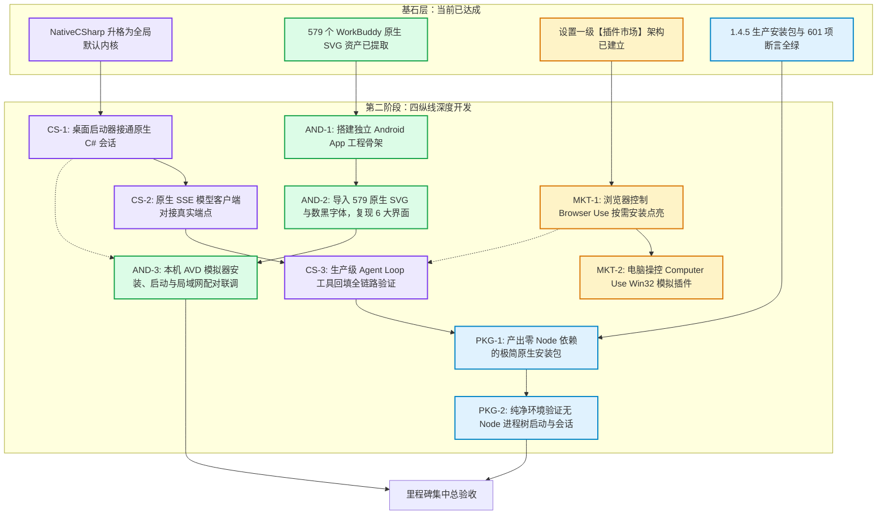

# Fufucode 第二阶段全景任务图与开发路线（v4 拓扑 · 原生内核与移动生态）

日期：2026-10-15  
制定者：主控 M（主控线程 `01a10ae0-9bb9-78f3-b2b3-fd3ceeb34d07`）  
目标：完成以 **C# 原生全托管内核为核心**、**WorkBuddy 移动端独立 App**、**插件市场按需装卸**与 **Node-free 极简打包**的生产级深度演进。

---

## 一、宏观架构与四纵线战略



---

## 二、逐项任务与派单分配表（Worktree、模型与难度）

根据用户额度纪律与模型分级表（`AGENTS.md`）：
- **S 级 / A 级**（`group/auto-gpt-6-1-sol`、`group/auto-hy4-preview-f`、`devin/swe-2`）：负责跨模块架构与主控单写；
- **B 级 max 思考强度**（`group/auto-deepseek-v4-1-flash`）：负责大任务包垂直攻坚；
- **免费 `devin/swe-2`**：负责机械测试、批处理验证与断言核验。

| 任务 ID | 任务名称 | 难度 | 推荐模型与思考强度 | 推荐 Harness | 独立 Worktree 分支与路径 | 交付产物与验收目标 |
|---|---|---|---|---|---|---|
| **CS-1** | 桌面端接入原生 C# 会话启动器 | **L3** | `auto-deepseek-v4-1-flash` (max) | Codex / 主控 M | `worktrees/cs1-desktop`<br>（`agent/cs1-desktop`） | 消除对 `node.exe` 的硬要求，桌面在无 Node 下直启原生会话 |
| **CS-2** | 原生 SSE 模型客户端真实端点打通 | **L3** | `auto-deepseek-v4-1-flash` (max) | Codex | `worktrees/cs2-provider`<br>（`agent/cs2-provider`） | 真实消费 OpenAI/DeepSeek 流式 SSE 与 Function Calls |
| **AND-1** | 搭建独立 Android 移动 App 骨架 | **L4** | `auto-gpt-6-1-sol` (medium) / M | Codex / 主控 M | `worktrees/and1-mobile`<br>（`agent/and1-mobile`） | 建立独立的 Android 工程，配置 SDK 36 与编译链 |
| **AND-2** | 注入 579 原生 SVG 与逐页界面对标 | **L3** | `auto-deepseek-v4-1-flash` (max) | Codex / OMP | `worktrees/and2-screens`<br>（`agent/and2-screens`） | 1:1 复现配对、会话列表、聊天流、审批卡片、紧急停止 |
| **AND-3** | 本机 AVD 模拟器安装与联调验收 | **L2** | `devin/swe-2` (免费) | Codex / 本机 | `main`（主控） | 启动 `wakeup_36` AVD，安装自制 APK，实测与桌面配对 |
| **MKT-1** | Browser Use 插件市场动态装卸与权限 | **L2** | `auto-glm-5-3-flash` (medium) | OMP / Codex | `worktrees/mkt1-browser`<br>（`agent/mkt1-browser`） | 插件市场点击安装后注册 CDP 工具集，卸载后注销 |
| **PKG-1** | 纯 C# 零 Node 极简安装包分发 | **L3** | `auto-deepseek-v4-1-flash` (medium) | Codex / 主控 M | `main`（主控单写） | 产出数十 MB 的独立 Setup，安装后进程树 100% 零 Node |

---

## 三、特种兵即插即用派单 Prompt

### 1. 派单 【CS-1：桌面端接入原生 C# 会话启动器】
```text
你是 Fufucode 受管特种兵。按 docs/tasks/native-csharp-runtime.md 执行任务 CS-1。
工作树：C:/Projects/Fucode/worktrees/cs1-desktop（分支 agent/cs1-desktop）。
任务目标：
在 src/Fufucode.App/Integration/RealSessionBootstrap.cs 与 RealSessionHost.cs 中，当新建或恢复会话为 NativeCSharp（csharp）时，消除对 node.exe 与 Pi cli.js 的强依赖！
直接调用 NativeCSharpChatSession 与纯 C# 原生内核启动会话，实现桌面端在完全没有 Node.js 的环境下也能丝滑创建并进入对话页面。
验收标准：
1. dotnet build src/Fufucode.App 0 警告 0 错误；
2. 即使 options.PiNodePath 为空且本地无 Node，创建 NativeCSharp 会话正常打开；
3. 停写、提交并发送单 JSON 交付卡至主控。
```

### 2. 派单 【AND-1/2：独立 Android 移动 App 建设】
```text
你是 Fufucode 受管特种兵。按 docs/tasks/M1-android-workbuddy.md 执行任务 AND-1。
工作树：C:/Projects/Fucode/worktrees/and1-mobile（分支 agent/and1-mobile）。
参考凭据：C:/Projects/Fucode/Fufucode/docs/records/workbuddy-reference-assets-map.md。
参考资产：C:/Projects/Fucode/Fufucode/assets/reference/workbuddy/icons/ 下的 579 个原生 SVG 图标及数黑字体。
任务目标：
建立独立的 Android 移动端工程，包名 com.fufucode.mobile，minSDK 24，targetSDK 36。
直接引入提取自官方 WorkBuddy 2.5.0 的 SVG 视觉资产与数黑字体，构建 6 大核心交互界面（连接配对、多会话列表抽屉、聊天时间线、单次审批卡、紧急停止、设备状态），并通过 HTTP/WebSocket 与桌面端 RemoteControlHost 服务通信。
验收标准：
1. 编译生成独立的 Fufucode-Mobile.apk；
2. 杜绝仅拿 WebView 包装旧网页，必须为真正的移动客户端；
3. 停写、提交并发送单 JSON 交付卡至主控。
```

---

## 四、第一步：当前立即执行（主控亲手落地）

作为主控，我们立即落地第一步：**【CS-1 核心切片：重构 `RealSessionBootstrap.cs` 与 `RealSessionHost.cs`】**，解除对 Node.js 的全局死锁，使桌面端选择原生 C# 内核时能够直接实例化 `NativeCSharpChatSession`！
