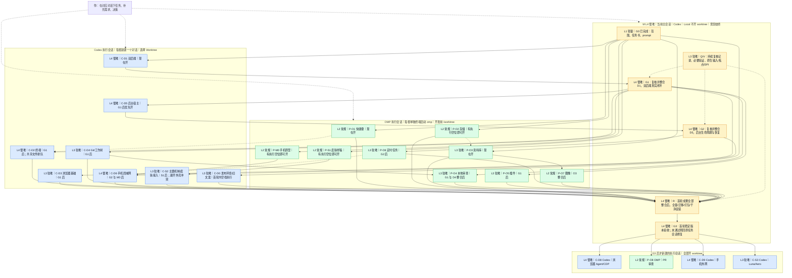

# 会话与任务开工图：照着创建对话即可

**历史CLI开工方案说明**：下文“一任务一会话”的分配保留用于既有任务追溯。2026-10-10用户新增的自动开发产品图改为“一个对话线程一个节点，线程内多个任务，按任务/交付部分打回”，见[最新U线程层级契约](../tasks/automation-workbench.md)与[交互原型](../frontend-prototype/automation/index.html)。不要用旧基数限制新产品，也不要据此迁移或接管已经运行的用户会话。

日期：2026-10-10。此文件把开发节点映射到实际 Codex/OMP 对话。它是操作入口；任务目标与验收仍以 `../tasks/launch-prompts.md` 和三类任务书为准。仅规划，不代表已创建这些对话或已完成产品任务。

本图仅解释用户如何管理会话。供模型执行的开工、协调、交付及下一步规则位于 [AI会话执行与交接协议](../tasks/session-handoff-protocol.md)，任务提示词位于 [launch-prompts](../tasks/launch-prompts.md)。只替换任务ID即可使用协议中的完整开工指令。模块交付待接线不等于整项验收通过。

## 先认清：软件、对话、代码目录

图和表中的L1-L4表示任务难度：L1轻量、L2常规、L3较难、L4很难。M派工时主动给原因和建议主模型档位，供你选择；工具需求另列，测试始终最低成本。AI执行真源见 [会话难度与派工提示](../tasks/session-difficulty.md)。

- **软件**：在 Codex 应用聊天的是 Codex 会话；在终端运行 `omp` 后聊天的是 OMP 会话。Codex 对话调用 OMP 时，对你仍是一个 Codex 对话，OMP 是它启动的执行进程。
- **对话**：承载需求与聊天历史。本方案每个执行对话只做一项任务，以及该任务的修复；不要求一个执行对话继续多个开发节点。
- **工作树**：代码所在目录。Codex/OMP 都可以使用 Git 工作树；软件名称不能证明是否隔离。

当前实测主仓库在 `C:\Projects\Fucode\Fufucode`，分支 main。已有 `C:\Projects\Fucode\Fufucode-omp`，分支 codex/omp-work。旧文档的 `C:\Projects\Fufucode` 已不适合作为本机启动目录。这些路径是当前机器操作记录，不是产品运行时硬编码。

旧常驻路径约定按用户重建目录这一事实重定位；执行时以实际仓库为准。不另行 git init，也不把文件夹复制当作创建工作树。

## 统一操作规则

**M 是当前主会话，Codex / Local，不开 worktree。其余开发任务均是一任务一会话，使用独立工作树。**原型也统一隔离，虽然技术上可以不隔离。这样用户不必按任务判断例外。

主会话负责进度、集成、G1/G2/G3、Q/V/R；执行会话只负责本任务和本任务修复。不把所有实现压到主会话，也不将测试/验收门当作另一个开发会话。Q/V 是贯穿工作：执行者先验证自己任务，M 复核并补必要的原生/集成验收。

所有执行会话都可由用户直接决策。一个任务通过并被整合后，不需要在该会话里接下一个任务；新任务新会话。需要回修时返回原会话。

**首次只启动 D1、O1、O3 三个执行会话。**后面等待依赖通过、旧任务交付后再开。默认最多三个执行会话同时写代码；图中节点多，不代表一次全开。共享核心、Styles、主窗口等文件发生重叠时，即使工作树不同也排队，不能认为有工作树就没有集成冲突。

## 合并后的会话-agent-开发节点图

每个任务框就是一个实际执行会话。`C-` 为 Codex，`P-` 为终端 OMP，均开 worktree。黄色框是 M 主会话内的验收或整合，不新建对话。实线是必须满足的依赖；虚线是贯穿工作或参考输入。



箭头“任务完成”均指：提交交付、M 复核整合、依赖证据满足。仅有执行者口头说完成不解锁后续任务。两个会话即使都标 Worktree，也必须核对实际路径不同。

## 你具体点哪里、输入什么

### 新建 Codex 执行对话

1. 在项目中创建新对话，选 **Worktree**，以最新整合后的 main 为起点。
2. 从任务 prompt 文件中复制对应的一段，加上下面的开工前缀，一起发送。
3. 让它把对话标题改为表中的名字；若无法改名，用户手动改。
4. 先核实实际目录是独立工作树，再让它修改代码。Codex 是否允许后续交接不影响此流程：开发期间不自行切到 Local。

### 新建 OMP 执行对话

每项任务开一个新的终端/标签页。先执行：

```powershell
Set-Location -LiteralPath 'C:\Projects\Fucode\Fufucode'
omp --model 'devin/swe-2'
```

进入 OMP 后输入 `/worktree`，选择用户已看到的 `Move this session into a new worktree, changes included`。完成后再发送任务 prompt 和开工前缀。本方案不额外假定菜单是否允许指定分支名、具体迁移路径或如何清理源改动；让它报告实际结果。

`changes included` 意味着现有改动可能随迁移进入工作树。当前主区已有用户未提交文件：必须先让 OMP 列出它们，标为继承内容，不覆盖、不提交、不清理。迁移后核对主区没有被意外改变；处理方式不明确时先只读报告，换干净起点的独立工作树后再开发。不要用 reset/clean 清场。

如果 devin/swe-2 当前供应商不可用，显式选已配置的低成本可用模型，并报告替代；本轮没有模型试跑。独立 OMP 会话和 Codex 内命令启动 OMP 是两种模式，本图默认用户直接开的交互 OMP 会话。

已有 Fufucode-omp 工作树可以留给一个执行者；不能让两个并行 OMP 会话都在它里面写代码。目录名不是身份，应记录每个会话实际路径。不要从已迁移会话继续打开多个任务，也不要在其工作树里再次输入 /worktree 来启动无关任务。

### 所有执行对话共同的开工前缀

将任务 ID 替换为当前一项，再接对应任务 prompt；旧 prompt 的机器路径按实际 cwd 重定位。

```text
本对话只负责【任务ID】，以及这项任务验收失败后的修复；不自动接其他任务节点。
先按实际当前仓库读取 AGENTS.md 与任务书。历史提示词中的 C:\Projects\Fufucode 已搬迁，不按旧绝对路径启动。
修改前输出身份卡：任务ID、启动方式（Codex应用/终端OMP）、实际工作目录、git rev-parse --show-toplevel、git worktree list、分支或detached HEAD、起点提交、已有改动。
用命令核实工作树，不凭对话自称判断。若实际工作目录仍是主目录，先准备独立工作树，不直接开写。
根据 execution-contract 核对文件范围；报告准备修改的共享文件，继承的用户改动不覆盖、不夹带提交。
测试/模型试跑显式使用最低成本可用模型。没有实际执行的检查写未验证。
只交付本任务，不自行集成main、不推送、不删除工作树。完成后给出交付卡，等待主会话验收；需要修复则在本会话继续。
```

开工身份卡模板：

```text
对话名：Codex｜D1｜WT（或 OMP｜O1｜WT）
软件/启动方式：
任务：
实际工作树路径：
分支或 detached HEAD：
起点提交：
已有改动与保护项：
允许修改范围：
依赖已整合的证据：
```

名称中的 WT 是用户可读标签，不是验证证据；实际路径和 Git 输出才是依据。

## 每个节点到底在哪个对话

| 任务 | 对话名 | 软件 | worktree | 何时创建 | 难度 |
| --- | --- | --- | --- | --- | --- |
| G0/G1/G2/G3/Q/V/R | 主控｜进度与集成｜Local | 当前 Codex M | 不开 | 已有；贯穿，不新建 | L4 很难 |
| D1 双后端 | Codex｜D1双后端｜WT | Codex | 开 | 第一批 | L4 很难 |
| O1 快捷键 | OMP｜O1快捷键｜WT | OMP | /worktree | 第一批 | L2 常规 |
| O3 资料库 | OMP｜O3资料库｜WT | OMP | /worktree | 第一批 | L3 较难 |
| D5 后台宿主 | Codex｜D5后台宿主｜WT | Codex | 开 | G1 后优先 | L4 很难 |
| D2 终端 | Codex｜D2终端｜WT | Codex | 开 | G1 后，避开共享文件冲突 | L4 很难 |
| D3 浏览器基础 | Codex｜D3浏览器｜WT | Codex | 开 | G1 后 | L3 较难 |
| D4 Git/工作树 | Codex｜D4Git｜WT | Codex | 开 | G1 后 | L3 较难 |
| O2 存储 | OMP｜O2存储｜WT | OMP | /worktree | 有空位即可 | L2 常规 |
| S1 皮肤样稿 | OMP｜S1皮肤样稿｜WT | OMP | /worktree | 有空位即可 | L2 常规 |
| M0 手机原型 | OMP｜M0手机原型｜WT | OMP | /worktree | 有空位即可，争取 G2 前完成 | L2 常规 |
| O5 插件 | OMP｜O5插件｜WT | OMP | /worktree | G1 后 | L3 较难 |
| O4 本地审查 | OMP｜O4本地审查｜WT | OMP | /worktree | G1 和 D4 整合后 | L3 较难 |
| O6 定时任务 | OMP｜O6定时｜WT | OMP | /worktree | G2 后 | L3 较难 |
| O7 图像 | OMP｜O7图像｜WT | OMP | /worktree | O3 整合后 | L2 常规 |
| D6 手机局域网 | Codex｜D6手机局域网｜WT | Codex | 开 | G2 和 M0 后 | L4 很难 |
| S2 皮肤接入 | Codex｜S2皮肤接入｜WT | Codex | 开 | S1 后；与外壳改动排开 | L3 较难 |
| D0 发布环境/文案 | Codex｜D0发布环境｜WT | Codex | 开 | 首轮内空档，最终打包前完成 | L3 较难 |
| D8 浏览器 Agent | Codex｜D8浏览器Agent｜WT | Codex | 开 | G3 后 | L4 很难 |
| O8 PR 审查 | OMP｜O8PR审查｜WT | OMP | /worktree | G3 后 | L2 常规 |
| D9 手机外网 | Codex｜D9手机外网｜WT | Codex | 开 | G3 后 | L4 很难 |
| S3 Luna/Aero | Codex｜S3皮肤扩展｜WT | Codex | 开 | G3 后 | L3 较难 |

这张表是计划分工，不是已存在的会话列表。Codex 原生子代理与上述用户可见对话不同；不会把它们混为同一个交付来源。

## 完成一个任务以后怎么操作

1. 执行模型在任务收尾时主动生成交付卡，写入本任务记录并在回复中展示；你无需催发或填写。它停止接新任务，保留工作树供验收。部分交付、阻塞及修复后的重新交付也由模型主动说明。
2. 将交付卡发给 M：“复核并整合此任务，先核对提交与用户改动，更新进度，告诉我现在可开启哪些新对话。”
3. M 通过验收后，再按表新建下一项对话。从最新整合后的 main 开始，不从未知脏工作树开始。
4. 未通过则回原执行对话：“根据这份验收问题，只修复本任务。”不要再开一个同任务写入者。

用户无需人工审查代码或执行集成命令。若授权 M 协调指定 Codex 对话，M 可读取交付而省去转发；终端 OMP 不会自动成为 Codex 侧边栏对话，仍通过交付卡/日志/提交提供证据。新 Codex 对话或外部 OMP 的调用都不因为这份计划而已经被创建。

采用一任务一会话的代价是对话和工作树较多，优点是标题即范围、依赖明确。交付后先保留以便修复，验收收编且核对未合并内容后才按所属工具流程回收；不直接删文件夹。计划不要求永远保留全部工作树，也不要求所有会话同时运行。
