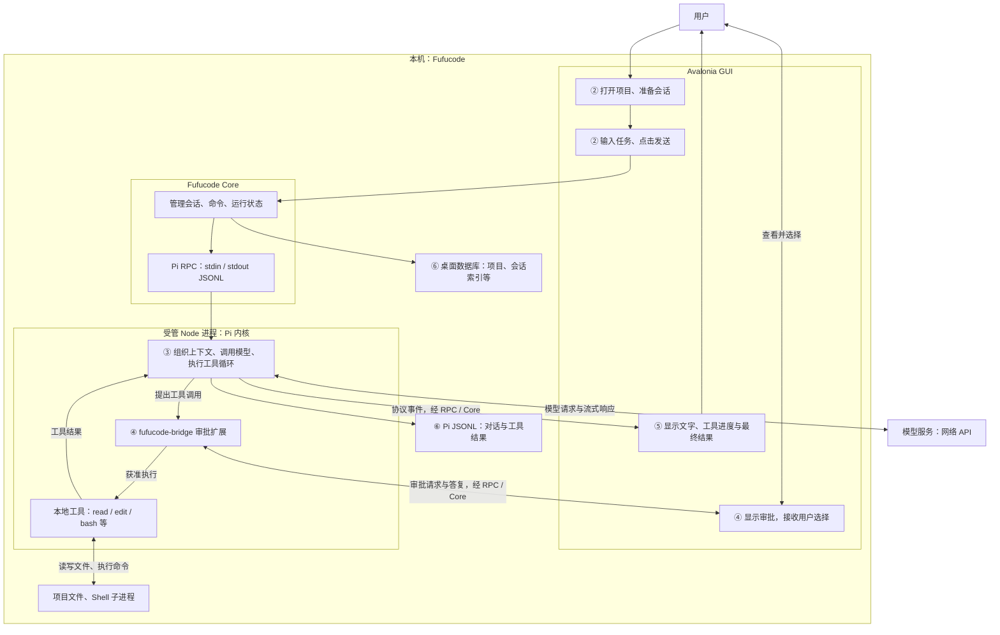
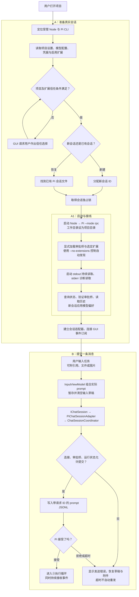
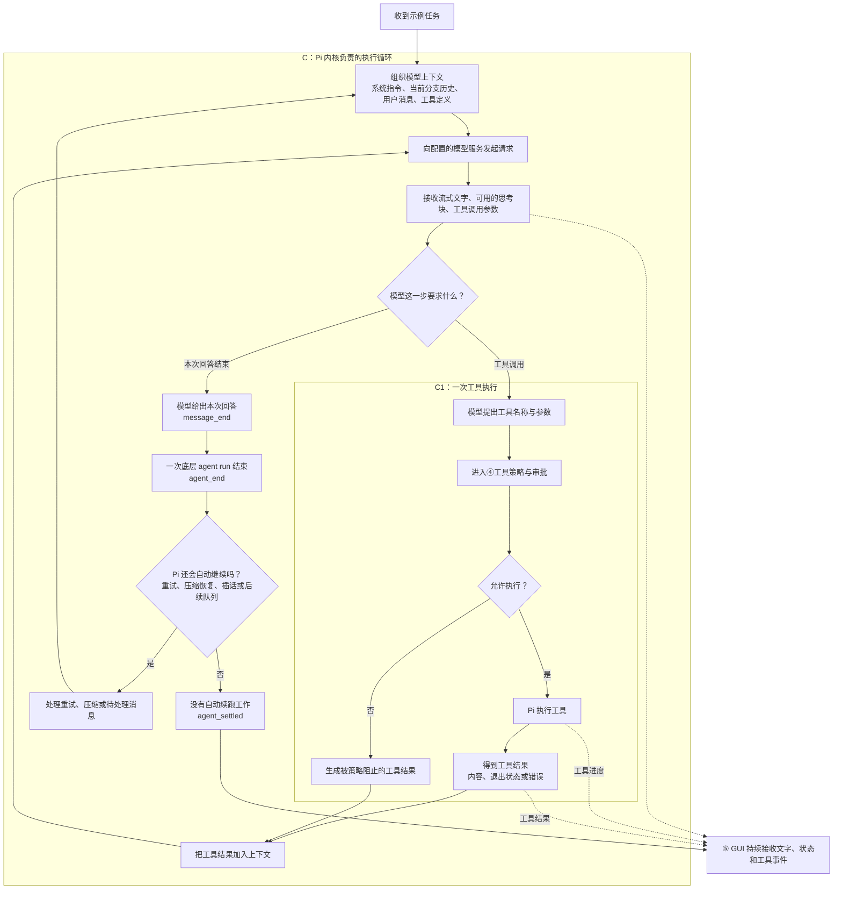
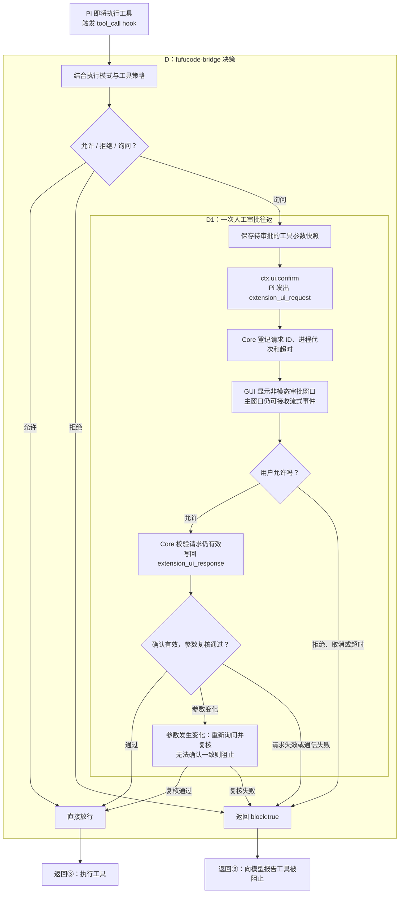
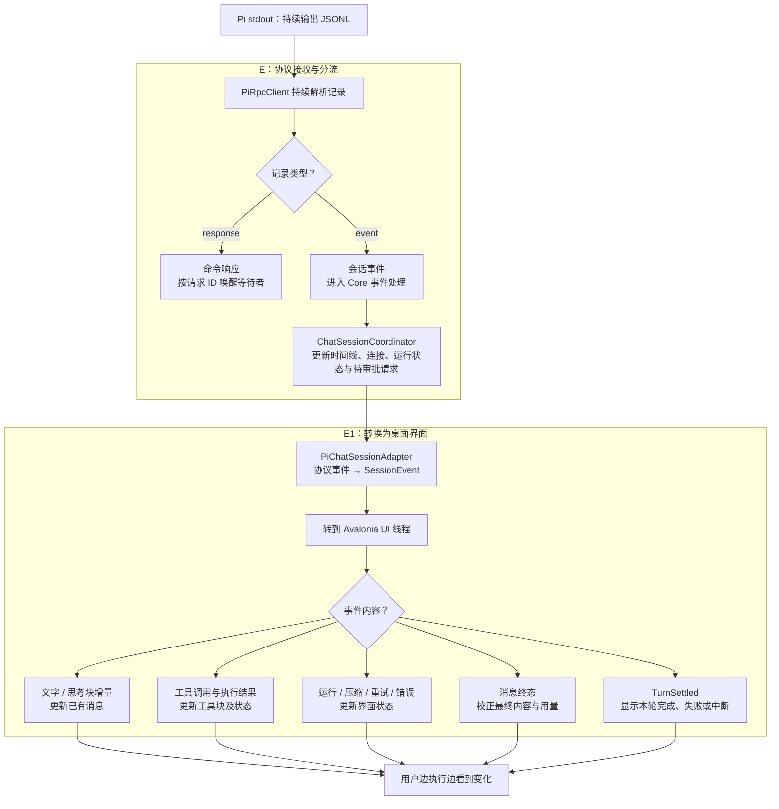
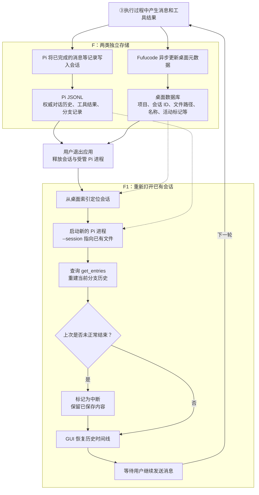
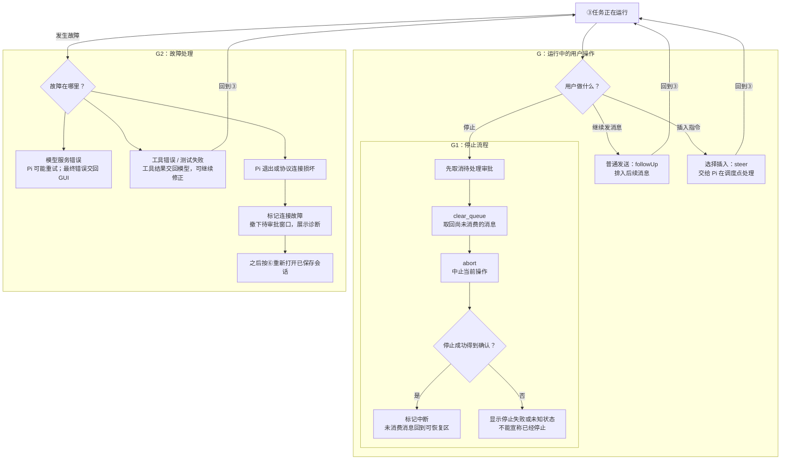

下面按**当前 Fufucode + Pi 1.1.0 的代码接线**展开。每个编号框都有对应的子流程，子流程里再嵌套更小的流程。

贯穿示例：用户说 **“修复 calculator.py 的除零问题，运行测试，并说明修改。”** 使用人工确认模式。这个例子用于说明链路，未实际执行。

**① 总图：一轮对话经过哪些地方**

这里有两条不同的连接：**Fufucode ↔ Pi 是本机进程管道；Pi ↔ 模型服务是网络请求。** 模型提出工具调用，Pi 在本机执行，GUI 展示过程并承接审批。

**② 展开“准备会话 → 用户发送”**

**`prompt` 的成功响应只表示消息被接受、排队或由扩展处理。它不表示任务完成。** 事件订阅与读取已经建立，所以即使模型很快返回，也能接住输出。普通文字在运行中再次发送，当前适配器会走后续消息队列。

**③ 展开“Pi 执行循环”：AI 怎样真正完成任务**

示例中，这个循环可能是：

**读取 calculator.py → 读取测试 → 编辑代码 → 执行测试 → 根据失败输出继续修改 → 再测试 → 说明结果。**

这个顺序由模型结合实际结果决定。工具失败或用户拒绝，并不必然结束整轮任务；Pi 可以把失败结果交回模型，让模型调整方案。

**④ 再展开“工具审批”：GUI 怎样参与内核执行**

当前四种模式会改变这个决策：

- **人工确认**：按工具策略决定放行、拒绝或询问。
- **自动审批**：自动允许未被策略禁止的内置 `write/edit`；Shell 与未知工具仍按策略处理。
- **完全访问**：审批桥放行所有工具。
- **规划模式**：只放行 `read/grep/find/ls`。

这些是应用审批策略，**不等于 Windows 系统沙箱**。扩展执行权限还需要结合扩展本身判断。

**⑤ 展开“结果回到 GUI”：为什么不是等最后才显示**

三个结束信号各有含义：

**`message_end`：一条消息结束。`agent_end`：一次底层运行结束。`agent_settled`：Pi 不会再自动继续这一轮。**

Fufucode 用最后一个信号结合错误与中断状态，判定本轮结果。“完成”表示本轮正常收尾；是否修复成功、测试是否通过，还要看工具结果。

**⑥ 展开“保存 → 关闭 → 再打开”：与 Durable 的边界**

**恢复历史，并不表示恢复原来的运行现场。** 当前链路会重新启动 Pi、读取已保存会话；它没有接入 Pi Durable 的执行状态恢复，也不会因此自动重放被打断的工具任务。

**⑦ 旁路：用户插话、停止，以及运行故障**

这组图的职责划分是：**Fufucode 管桌面交互、审批策略、展示与进程生命周期；Pi 管上下文、模型调用、工具循环和对话历史。** Codemode、MCP、tool-search 可以扩展③里的执行能力，但当前产品没有默认启用；Subagent 与 Durable 也没有接入这条主链路。

图中接线已核对当前源码，未重新运行 GUI 或模型实验。主要依据：[会话启动](/C:/Projects/Fufucode/src/Fufucode.Core/PersistentSessionManager.cs:242)、[运行状态与收尾](/C:/Projects/Fufucode/src/Fufucode.Core/ChatSessionCoordinator.cs:486)、[审批桥](/C:/Projects/Fufucode/extensions/fufucode-bridge/index.ts:109)、[GUI 事件适配](/C:/Projects/Fufucode/src/Fufucode.Core/PiChatSessionAdapter.cs:177)、[历史存储边界](/C:/Projects/Fufucode/src/Fufucode.Core/DesktopMetadataStore.cs:16)。