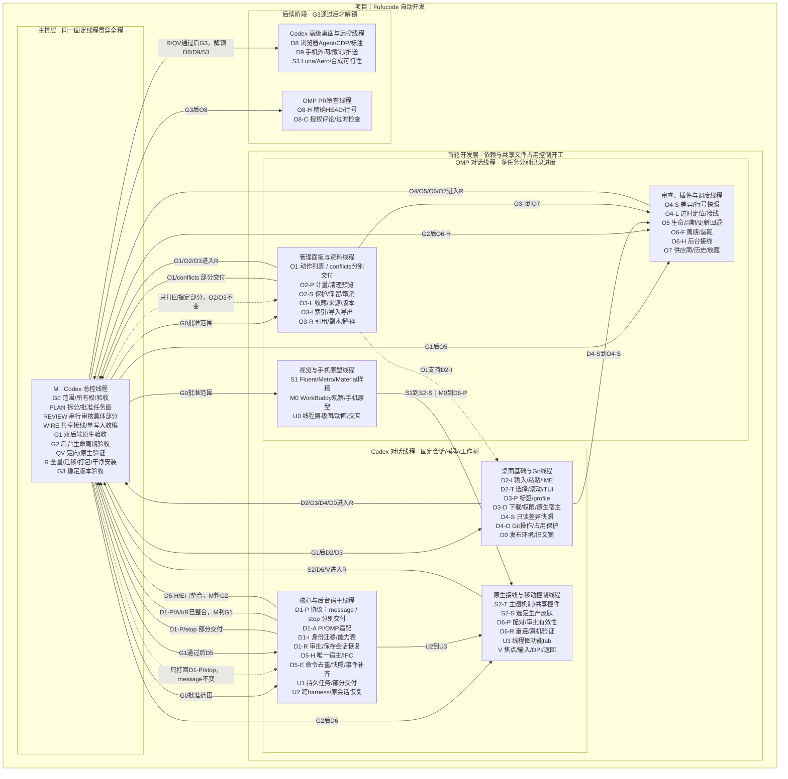

# 自动开发：线程、任务与部分交付

用户最新产品约定：**节点是对话线程，线程内有多个任务；打回只针对具体任务的具体交付部分。**主控、执行阶段、Harness是大的分组。以下是产品示例，不表示真实线程已经创建，也不重新分配在途任务。

同一线程可以同时有“已集成”“执行中”“待门禁”“局部修复”的任务。线程总进度不能代替某个任务/部分的验收。部分回修产生新运行版本，不覆盖历史决定；依赖继续按精确部分、实际集成和门禁判断。

[打开动画HTML](../frontend-prototype/automation/index.html)：9个线程、50个任务、51条任务端口连线。HTML连线绑定到任务行，比静态Mermaid能更明确表示线程内部的依赖与局部回修。[AI执行契约](../tasks/automation-workbench.md)是协议真源。
